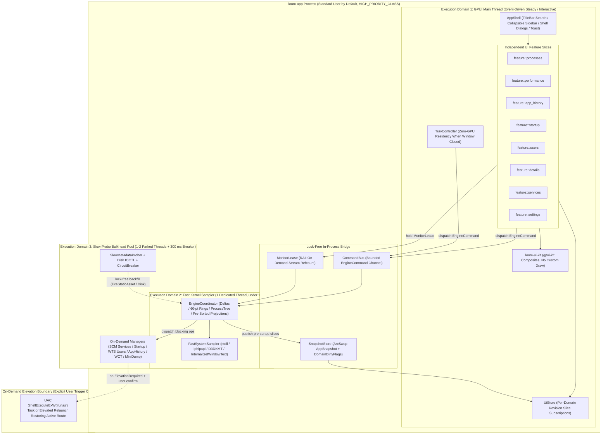
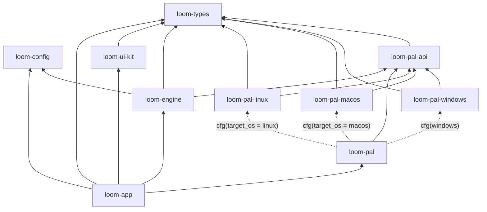

# System architecture

English | [中文](architecture.zh.md)

Loom is a cross-platform (Windows / macOS / Linux) native desktop Task Manager built with **Rust** and **GPUI Kit (`gpui-kit` / `gpui-component`)**. Development targets **Windows** first—matching the core capabilities of the built-in Windows 11 Task Manager while addressing **slow cold starts, high-load UI stutters, and startup hangs caused by hung windows or stalled storage devices**—and defines a compile-time Platform Abstraction Layer (PAL) ready for Linux and macOS backends.

<a id="core-architectural-principles"></a>

## 1. Core architectural principles

1. **Headless & runtime-free core**: System sampling, delta computation, process-tree construction, search/sort indexing, and command dispatch live in UI-agnostic crates (`loom-engine` and below) without a multi-thread `tokio` runtime, avoiding dozens of idle worker threads on high-core-count CPUs (such as 32-thread processors).
2. **Compile-time static PAL**: Windows, macOS, and Linux backends live in separate crates bound via associated types, zero-sized extension types (ZSTs), and `#[cfg(target_os)]` type aliases in `loom-pal`, avoiding `dyn Trait` vtables and boxed futures on hot paths.
3. **Dual-lane bulkhead isolation**: Sub-millisecond in-memory kernel queries (Fast Lane) are isolated from potentially blocking disk, shell, and driver metadata probes (Slow Lane) guarded by per-device `300 ms` circuit breakers, reducing startup freezes and runtime hangs.
4. **Cold/hot data separation & buffer reuse**: Processes are keyed by `(pid, create_time_100ns)` to handle PID reuse. Hot metrics use `Copy` structs written into reusable scratch buffers; cold metadata (icons, PE publisher, command line) is resolved once and shared via two-tier `Arc` interning.
5. **Feature-sliced, component-composed UI**: `loom-app` is organized into self-contained `shell` + `features/*` modules built by composing `gpui-kit` controls (`Table`, `AreaChart`, `LineChart`, `Sidebar`, `TitleBar`, `Dialog`, `PopupMenu`, `Tree`, `Select`) and Flexbox primitives—avoiding root-level global state structs, monolithic modal enums, and custom `Canvas`/shader drawing.
6. **Domain-sliced snapshots, event-driven wakeup & RAII `MonitorLease`**: Snapshots publish lock-free via `ArcSwap<AppSnapshot>` with monotonic per-domain `Revision` counters and zero-polling `SnapshotWakeSignal` push wakeups to `UiStore`. On-demand domains (`Services`, `Startup Apps`, `Users`, `App History`, per-core grids, elevated-only `ProcessNetwork` ETW) poll only while leased via RAII `MonitorLease`.
7. **Standard-user launch & on-demand elevation**: Loom launches under standard user privileges without a startup UAC prompt, elevating only when acting on protected system processes, services, or administrative tasks.

<a id="performance-budgets-and-anti-hang-architecture"></a>

## 2. Performance budgets and anti-hang architecture

### 2.1 Engineering resource budgets

Target budgets measured against modern multi-core desktops (16 cores / 32 logical processors, 400+ processes, 10,000+ threads):

| Dimension | Loom Target Budget | Stock Windows 11 Task Manager Baseline Issue |
| --- | --- | --- |
| **Cold-start time to interactive** | **`< 50 ms`** (immediate priority boost, `< 35 ms` first interactive process table) | `800 – 3000+ ms` due to XAML Islands, COM, and WMI/PDH startup stalls |
| **Fault resilience on launch** | **Slow-I/O bulkhead + `300 ms` circuit breakers** | Prone to stalls or blank windows on hung apps, spun-down HDDs, faulty USB drives, or unreachable SMB shares |
| **Steady-state CPU (1s refresh)** | **`< 0.15%`** (`< 1 ms` single kernel sweep + delta calculation) | Commonly `0.8% – 3%+`, spiking on core grids or fast scrolling |
| **Idle & minimized GPU load** | **Event-driven redraw at refresh cadence (e.g. `1 FPS` at 1s); `0% GPU` when minimized / closed to tray** | Higher XAML composition bridge overhead |
| **Private working set (RAM)** | **`30 – 45 MB`** (target `< 45 MB`; reused scratch arenas + `20×20` icon cache) | Typically `80 – 160+ MB` |
| **Process OS thread count** | **`6 – 8` threads maximum** | Commonly spawns `30 – 60+` COM, XAML, WMI, and thread-pool workers |

### 2.2 Progressive cold-start pipeline (`< 50 ms` target)

```mermaid
sequenceDiagram
    autonumber
    participant Main as "GPUI Main Thread (loom-app, GUI Subsystem)"
    participant Fast as "Fast Kernel Sampler (HIGH / ABOVE_NORMAL)"
    participant Slow as "Slow Probe Bulkhead Pool (max 2 Threads, Low Priority)"

    Note over Main: T = 0 ~ 2 ms (GUI Subsystem, Priority Boost, Mutex Lock & Config Load)
    Main->>Main: SetPriorityClass(HIGH_PRIORITY_CLASS) to preempt 100%-CPU workloads
    Main->>Main: Acquire cross-UIPI named mutex only (defer receiver window & thread)
    Main->>Main: Load settings.toml (under 4 KB, no Registry/COM wait)
    par Parallel Window Init & Background Engine/Tick-0 Boot
        Main->>Main: gpui_kit::open_window initializes surface, single theme/accent pass & shell
    and
        Main->>Fast: Return immediately; construct samplers/pool off-thread & run Tick 0 (~1-2 ms, skip GPU discovery)
        Fast-->>Main: Publish Frame-1 Process Slice (PID / image name / memory / status)
    end
    Note over Main: Strictly after first frame paint (window.on_next_frame): start WM_COPYDATA receiver, tray icon & global hotkey
    Fast->>Fast: T = +250 ms calibration tick enables cooldown-cached D3DKMT per-process GPU telemetry, then enters 1s cadence
    Fast-)Slow: Prioritize foreground App cold probes (descending private WS) ahead of background/system processes
    Slow-->>Main: Backfill icons & descriptions asynchronously without blocking UI
```

- Release builds enable `#![cfg_attr(not(debug_assertions), windows_subsystem = "windows")]` on Windows alongside `[profile.release]` (`lto = "thin"`, `codegen-units = 1`, `strip = "symbols"`), avoiding Windows console host allocation overhead and shrinking binary footprint.
- `loom-app` exposes an opt-in, zero-overhead-when-disabled `--startup-trace` / `--startup-trace=<path>` CLI flag recording microsecond phase milestones from `main_start` through `first_frame_painted`, `post_frame_shell_init`, and `tick0_snapshot_ready`.

### 2.3 Six Windows anti-hang constraints

1. **No WMI or PDH dependencies**: Do not call `IWbemServices` (cross-process RPC to `Winmgmt`) or `PdhOpenQuery` (loads third-party performance counter DLLs under global registry locks). Query CPU/processes via `ntdll`, NICs via `iphlpapi`, disks via guarded `IOCTL` calls, GPUs via `DXGI + gdi32!D3DKMT`, and RAM speed/slots via in-memory `GetSystemFirmwareTable('RSMB')` SMBIOS parsing (`< 0.05 ms`).
2. **No synchronous cross-process window messages**: Do not call `GetWindowTextW` or blocking `SendMessageW`, which can block indefinitely if another desktop app is hung. Use `InternalGetWindowText` and non-blocking `IsHungAppWindow`.
3. **Slow-disk, safe-eject & remote-share bulkhead circuit breakers**: Bypass deep file opens on UNC or `DRIVE_REMOTE` paths (falling back to memory-only `SHGFI_USEFILEATTRIBUTES` icons), enforce PnP storage driver allowlisting (`stornvme`, `storahci`, `atapi`), guard rotational HDDs against idle spin-ups, and subscribe to `CM_Register_Notification` (`DEVICEQUERYREMOVE`) for safe USB ejects. Isolate storage `IOCTL` probes (`IOCTL_STORAGE_QUERY_PROPERTY`, `IOCTL_VOLUME_GET_VOLUME_DISK_EXTENTS`, and per-device `IOCTL_DISK_PERFORMANCE`), shell icon lookups, Restart Manager file-lock queries, and PE version reads inside the Slow Probe Pool; any volume exceeding `300 ms` trips a 60-second `CircuitBreaker` cooldown so the Fast Lane remains non-blocking.
4. **No cross-process PEB reads via `ReadProcessMemory`**: Query command lines via `NtQueryInformationProcess(ProcessCommandLineInformation)` to avoid stalls on suspended or paged-out targets.
5. **No network revocation checks during publisher lookup**: Prefer local PE `VersionInfo` (`CompanyName` / `FileDescription`); when invoking `WinVerifyTrust`, pass `WTD_CACHE_ONLY_URL_RETRIEVAL` to avoid outbound CRL/OCSP waits.
6. **No persistent target process handles**: Extract the bulk of dynamic metrics directly from `SystemProcessInformation` buffers; open `PROCESS_QUERY_LIMITED_INFORMATION` handles transiently and close them immediately after querying.

<a id="system-topology-and-execution-domains"></a>

## 3. System topology and execution domains

Loom separates work into **three execution domains** inside a single user-mode process, crossing an elevation boundary only on explicit user action:



<a id="workspace-module-layout-and-dependency-dag"></a>

## 4. Workspace module layout and dependency DAG

A 10-crate Cargo Workspace enforces a compile-time acyclic dependency graph:



### Crate responsibilities and boundaries

| Crate | Kind | Core Responsibility | Dependency & Decoupling Boundary |
| --- | --- | --- | --- |
| `loom-types` | lib | Cross-platform compact domain models (`ProcessKey`, `ProcessHotSample`, `ProcessColdMeta`, gap-aware `HistoryRing`/`ThroughputRing`, `CpuCoreKind`, `d3_asleep`, `ProcessSocketRecord`, `FileLockHolder`, `LeakWarning`, `WebView2Role`, `TaskManagerReplacementStatus`, `AdminStartupStatus`, hardware snapshots, services, startup entries, sessions, history, `CapabilityFlags`). | No OS or UI dependencies; hot structs use `Copy` POD layouts. |
| `loom-config` | lib | Local configuration (`settings.toml`: startup page, refresh cadence, theme, locale, window bounds, always-on-top/tray behavior, column preferences, global hotkey, additive v1 process/diagnostic toggles), frozen `v1` (`CONFIG_CONTRACT_VERSION = "1.0"`) forward migrations, atomic writes. | Synchronous load targeting `< 1 ms`; no dependency on platform backends or UI; tolerates unknown future optional keys and rejects unsupported future `schema_version`. |
| `loom-pal-api` | lib | Frozen `v1` (`PAL_API_CONTRACT_VERSION = 1`) static PAL traits (`PlatformBackend`, `FastSystemSampler`, `SlowMetadataProber`, `ServiceManager`, `StartupManager`, `SessionManager`, `AppHistoryReader`, `SystemOperator` with defaulted additive methods for suspend/resume, Explorer restart, file-lock queries, listening ports, elevated ETW gating, system Task Manager replacement, and persistent administrator startup), caller-reused `SampleScratch` arenas, and `PalError`. | Depends solely on `loom-types`; does not expose raw OS handle or header types. |
| `loom-pal-windows` | lib | Windows sampling and system control backend (`ntdll` idle-cycle CPU & `ProcessSequenceNumber`, pure `D3DKMT` GPU + `D3` power-gate, guarded `IOCTL`, `SMBIOS`, `SCM`, `WTS`, `WCT`, `MiniDump`, `iphlpapi` ports, Restart Manager file locks, elevated-only ETW process network, plus IFEO Task Manager replacement, Task Scheduler persistent administrator startup, and cross-UIPI single-instance activation). | Compiled only under `cfg(windows)` using `windows-sys`; encapsulates `unsafe` FFI and enforces the six anti-hang constraints. |
| `loom-pal-macos` | lib | macOS backend skeleton (`Mach` / `libproc` / `IOKit` / `launchd` targets). | Compiled only under `cfg(target_os = "macos")`; contract stub scheduled for full implementation in `0.3.0`. |
| `loom-pal-linux` | lib | Linux backend skeleton (`procfs` / `sysfs` / `netlink` / `drm` / `systemd` targets). | Compiled only under `cfg(target_os = "linux")`; contract stub scheduled for full implementation in `0.2.0`. |
| `loom-pal` | lib | Compile-time platform facade (`pub type NativeBackend = ...`) plus single-instance lock, tray adapter, and power/display observers. | Keeps `#[cfg(target_os)]` conditionals out of upper crates without vtable indirection. |
| `loom-engine` | lib | Headless sampling and orchestration engine (`EngineCoordinator<B>`, `SnapshotWakeSignal`, delta engine, gap-aware 60-point rings, anti-reuse process tree, structured search + on-demand `:PORT`, row-order & Hold-`Ctrl` freeze, default-ON transitivity-safe sort deadband hysteresis, reusable `ProjectionScratch`, WebView2 host attribution, zero-syscall leak warnings, pre-sorted view projections across all tables, `MonitorLease`). | Prohibits GPUI or multi-thread Tokio; headless-testable against `MockBackend`. |
| `loom-ui-kit` | lib | Thin composition layer over `gpui-kit`: WCAG 2.1 contrast-verified semantic tokens with per-theme caching (`CachedSemanticColors`), uniform monospace numeric fast-shaping (`MetricDisplay` / static lookup tables), bounded `RowTextCache`, single-line preview capping, heatmap cells, gap-aware sparkline cards, stepped chart ceilings, adaptive core-grid solver (`8%` hysteresis), active GPU engine selection, stable ordering, formula-safe CSV helpers, segmented memory bars, and `rust-i18n` helpers. | No custom `Canvas`/shader drawing; holds no domain state. |
| `loom-app` | bin | Desktop composition root & feature-sliced UI: priority boost, progressive boot pipeline, `AppShell`, and 8 isolated `features/*` modules. | Feature slices do not cross-import internals; cross-view jumps (`JumpToDetails`, `JumpToServices`) route through `ShellHandle`. |

<a id="feature-sliced-ui-architecture"></a>

## 5. Feature-sliced UI architecture (`loom-app` & `loom-ui-kit`)

```text
crates/loom-app/src/
├── main.rs                  # Entrypoint: HIGH_PRIORITY_CLASS boost, single-instance check
├── bootstrap.rs             # Parallel settings load + EngineCoordinator<NativeBackend> + GPUI window open
├── bridge/
│   ├── store.rs             # UiStore: per-domain Arc<*Slice> + Revision subscriptions
│   ├── commands.rs          # EngineCommand dispatch & ElevationRequired notification prompt
│   └── monitor_lease.rs     # RAII MonitorLease guard (auto-releases on unmount or minimize)
├── shell/
│   ├── window.rs            # Root-wrapped window (TitleBar search + collapsible Sidebar + outlet)
│   ├── nav.rs               # Declarative route registry & cross-view NavigationIntent bus
│   ├── dialogs.rs           # Cross-view shell dialogs only (Run new task / generic confirmations)
│   └── tray.rs              # Resident tray controller (destroys GPUI window on close to free VRAM)
└── features/                # 8 autonomous vertical slices with no cross-imports
    ├── processes/           # Categorized groups / parent-child tree toggle + heatmap table + menu
    ├── performance/         # Left sparkline device rail + CPU/Memory/Disk/Network/GPU views
    ├── app_history/         # Cumulative resource usage table + clear history action
    ├── startup/             # Startup entries + Last BIOS time + enable/disable controls
    ├── users/               # Expandable user-session process tree + disconnect actions
    ├── details/             # Full-column table/tree + scoped Affinity / Wait Chain dialogs + menu
    ├── services/            # SCM services table + start/stop/restart toolbar + PID jump
    └── settings/            # Startup page / update speed / always-on-top & tray / theme & locale
```

Feature-specific dialogs (such as `Set affinity` and `Analyze wait chain` inside `features/details/`) remain scoped to their owning slice and open through `gpui-kit`'s `Root` dialog layer, avoiding a monolithic global modal enum in `shell/`.

### 5.1 Sliced read-only projections

`AppSnapshot` partitions state into independent `Arc` slices pre-sorted, pre-filtered, and tree-flattened off the UI thread inside `loom-engine`:

- `processes: Arc<ProcessTableSlice>` (flattened `Vec<ProcessRowProjection>`; selection and right-click actions anchor to `ProcessKey` rather than row index so dynamic resorts do not target the wrong process; supports `MonitorDomain::Processes` RAII lease gating so desktop sessions skip per-tick process table projection while away from the Processes tab and tray quick-overview; `ProjectionEngine` is parameterized by `PlatformBackend::PLATFORM` so Windows Task Manager-aligned shell un-nesting and multi-process app aggregation apply strictly to `PlatformKind::Windows` without altering Linux/macOS grouping or true OS `Process Tree` views)
- `details: Arc<DetailsTableSlice>` (projected only while `Details` holds an active `MonitorLease`)
- `performance: Arc<PerformanceSlice>` (device summaries, 60-point quantized history rings, and static hardware metadata)
- `services: Arc<ServicesSlice>` / `startup: Arc<StartupSlice>` / `users: Arc<UsersSlice>` / `app_history: Arc<AppHistorySlice>` (gated by `MonitorLease`; no polling overhead while unmounted, and when active their filtering, Schwartzian sorting, and `Users` session-tree flattening also run off the UI thread inside `loom-engine`)
- `settings: Arc<SettingsSlice>` (read-only configuration projection)

**Layered engine & UI list-rendering optimizations**:

- **Stable, low-allocation engine projections**: Default-ON transitivity-safe **Sort Deadband (hysteresis)** (`< 0.2%` CPU/GPU, `< 16 KiB/s` Disk/Network) precomputes dense deadband sort keys (`ProjectionScratch::dense_deadband`) and dense frozen ranks (`dense_frozen_ranks`) in `O(N)` before sorting so comparisons perform zero `HashMap` lookups; reuses the coordinator's pre-parsed `ParsedQuery` across ticks; caches static-column sort order in `Details` keyed by live-key signature and `ColdMetaCache::version` to skip steady-state `O(N log N)` string comparisons; consolidates per-row cold-cache lookups and `O(1)` parent-index lookups; coalesces cold-metadata arrival bursts over a short `40 ms` window to avoid startup projection storms; and pairs these with persistent reusable `ProjectionScratch` arenas (`HashGroupIndex`, `FoldedKeyArena`) and `ColdMetaCache` precomputation (`webview2_role`, `webview2_host_exe`, `user_name_short`).
- **UI hot-path & `gpui-fast` synergy**: `loom-app` enables `gpui-kit`'s `gpui-fast` rendering backend (Retained Subtrees + Splice, Taffy layout node retention, `NumberShaping`, GPU Scroll Layers, and D3D11 state deduplication) and isolates static page toolbars from high-frequency 2D-virtualized `DataTable` entities (`Entity<TableState<D>>`). Table delegates eliminate per-frame allocations and redundant repaints via:
  - Per-theme caching of all 19 WCAG semantic color tokens (`CachedSemanticColors`), cached localized header strings (`*LocaleCache`), and cached grouped section-header count labels;
  - Uniform monospace typography (`mono_font_family`) with `MetricDisplay` (numeric spans restricted to `gpui-fast::NumberShaping`'s ASCII character set, backed by static integer tables, lazily-chunked tenths and signed-delta lookup tables, and bounded `RowTextCache`, skipping redundant rounded/transparent background styling for `HeatmapLevel::None`);
  - Per-frame GPU icon texture upload budgeting in `IconRenderCache` (`MAX_ICON_UPLOADS_PER_FRAME = 6`): cache hits consume zero budget while excess uncached icons render a lightweight vector placeholder on the current frame and automatically catch up via `window.on_next_frame`, eliminating frame-time spikes when scrolling rapidly across newly seen processes;
  - 256-character single-line preview capping for long `CommandLine`/`ExePath` cells with on-demand `Stateful` ID and `Tooltip` attachment only when text can overflow the column width (preserving full text for Copy and CSV export), plus flattened cell DOM wrappers for plain text and badge-free Name cells to reduce Taffy layout nodes;
  - Table-level right-click capture with `TableColumnLayout::column_index_at_x` column hit-testing (replacing per-cell listeners), lightweight expand chevrons, empty-status badge short-circuiting, isolated header `SortPausedBadge` entities (so hover-freeze transitions never repaint the whole table), isolated toolbar selection-action button entities (`ToolbarActionButton`, so row selection toggles repaint only that button rather than the outer page toolbar), and gated `a11y` string assembly;
  - `visible_rows_changed`/`visible_columns_changed` + `ViewportFingerprint` dirty checking (preserving fingerprints across programmatic selection re-anchoring), `O(1)` selection row hint caching (`selected_row_hint`) across lookup paths, `ScrollBurstCoalescer` (`150 ms` quiet / `500 ms` hard cap, bypassed immediately on user actions), and zero-allocation atomic list-render telemetry (`ListTelemetryRegistry` recording commit latency, fingerprint skip rate, scroll coalescing, and icon throttling metrics surfaced safely in `tracing::debug!` and the privacy-safe Diagnostic Summary) to keep wheel/drag scrolling on `gpui-fast` GPU Scroll Layers. `TableDelegate::render_td` performs `O(1)` slice indexing across only the visible viewport rows and columns (targeting `< 0.5 ms` per frame / smooth 120 FPS scrolling on the UI thread).

### 5.2 `gpui-kit` widget mapping

| UI Surface / Visual Element | `gpui-kit` (`gpui-component`) Control | Composition Strategy (No Custom Drawing) |
| --- | --- | --- |
| **Window chrome & global search** | `Root` + `TitleBar` + `Input` | Centered debounced `.cleanable(true)` structured search input (`OR ,`, `AND`, `!`/`-` negation, `pid:`, `user:`, `cpu:`, `mem:`, `status:`, on-demand `:PORT`) + keyboard shortcuts (`Ctrl+F`, `Ctrl+1..8`, `F5`, `Space`, Hold-`Ctrl` freeze) |
| **Collapsible navigation rail** | `Sidebar`, `SidebarMenu`, `SidebarMenuItem`, `SidebarFooter` | Hamburger toggle switches `.collapsed(bool)`; `Settings` pinned in `SidebarFooter` |
| **Virtualized tables & tree tables** | `DataTable` + `TableState<D>` + `TableDelegate` | Left-pinned `Name` column (`fixed_left`) composes `h_flex().pl(px(depth * 16.))` + lightweight chevron + cached `Img`; uniform monospace metric cells (`NumberShaping`-friendly); 2D virtualization with viewport dirty-checking & scroll-burst coalescing; default-ON sort deadband + pause-sort-on-hover row stabilization; formula-safe UTF-8 BOM CSV export; WebView2 host attribution & zero-syscall leak warning pills; single table-level row `ContextMenu` with x-coordinate column hit-testing |
| **Multi-level context menus** | `PopupMenu` / `.context_menu(...)` | Supports checkmarks (`✓ Efficiency mode`), Suspend/Resume, Restart Explorer, File Lock Finder, Copy summary, separators, and nested submenus (`Set priority >`, `Resource values >`) |
| **Performance left device sparklines** | `v_virtual_list` + `AreaChart` | Gap-aware `AreaChart` cards with open-time stable Disk/Network ordering (`merge_stable_order`), stepped network ceilings, and honest `Sleeping (D3)` / `—` GPU status |
| **CPU kernel-time overlay & core grid** | Multi-series `AreaChart` + adaptive grid | Dual `.y(...)` accessors render total + kernel utilization gradients; adaptive logical-core grid (`compute_core_grid_layout` with `8%` resize hysteresis and `Full`/`Short`/`Hidden` header tiers) colors `P`/`E`/`LP-E` cores distinctly |
| **Disk dual charts / NIC / GPU engines** | `AreaChart` / `LineChart` + `Select` | Stepped ceilings (`stepped_throughput_ceiling` / `stepped_network_ceiling`) eliminate axis jitter; GPU `2×2` grid auto-selects active `>= 1%` engines (`select_active_gpu_engines`) while preserving user `Select` overrides |
| **Memory composition bar** | `h_flex` + `relative(ratio)` + `Tooltip` | Proportional Flexbox segments (`In use / Modified / Standby / Free`) with hover `Tooltip` |
| **Run Task / Affinity / WCT / File Locks / Tray** | `Dialog`, `Input`, `Checkbox`, `Tree`, `Notification` | Wait-chain blocking graphs render in `Tree`; Restart Manager file-lock finder surfaces lock holders; `ElevationRequired` surfaces a relaunch `Notification`; `0%`-GPU tray quick-overview popover shows live CPU/RAM/top processes without mounting the main window |

<a id="core-backend-subsystems"></a>

## 6. Core backend subsystems

### 6.1 Anti-PID-reuse process tree & tree termination (`loom-engine` & `loom-pal-windows`)

Windows frequently recycles exited `PID`s. Loom keys each process instance by `ProcessKey { pid, create_time_100ns }`:

- **Parentage validation**: A process attaches to `parent_pid` only if `parent.create_time_100ns <= child.create_time_100ns`; otherwise it promotes to a root node, preventing cyclic trees and stale metadata collisions.
- **Bottom-up tree termination (`KillProcessTree`)**: Collects validated descendants by `ProcessKey` and suspends/terminates leaves before parents so watchdog parents do not respawn children mid-termination.
- **Two-tier cold asset deduplication**: `ProcessKey -> Arc<ProcessColdMeta> -> Arc<ExeStaticAsset>` (keyed by normalized path). Extracted icons are downsampled to `20×20` RGBA8 (`1.6 KB` per unique binary) and shared across multi-process apps.

### 6.2 WMI/PDH-free hardware telemetry (`loom-pal-windows::performance`)

- **CPU**: Prefers `NtQuerySystemInformationEx(SystemProcessorIdleCycleTimeInformation)` with QPC-validated per-group baselines (falling back cleanly to `SystemProcessorPerformanceInformation`); `GetLogicalProcessorInformationEx` cached at boot classifies heterogeneous `P`/`E`/`LP-E` cores (`EfficiencyClass` + L3 sharing) alongside sockets, physical cores, NUMA, and L1/L2/L3 caches; `CallNtPowerInformation` reports live clock speed (GHz).
- **Memory**: `GlobalMemoryStatusEx` + `GetPerformanceInfo` + `SystemMemoryListInformation` for memory composition; `GetSystemFirmwareTable('RSMB')` parsing for RAM speed (MT/s), slots used, and form factor.
- **Disk**: `IOCTL_VOLUME_GET_VOLUME_DISK_EXTENTS` maps physical drives to drive letters (e.g., `Disk 0 (C: D:)`), `IOCTL_STORAGE_QUERY_PROPERTY` identifies NVMe / SATA SSD / HDD and model strings, and `IOCTL_DISK_PERFORMANCE` provides active time, read/write rates, and response latency with `checked_sub` reset hardening, PnP driver allowlisting, HDD activity guards, `CM_Register_Notification` safe-eject cooperation, and `300 ms` circuit-breaker timeouts.
- **Network**: `GetIfTable2` + `GetAdaptersAddresses` provide 64-bit octet counters (`checked_sub` reset-safe), link speeds, media type (Ethernet / Wi-Fi), and IPv4/IPv6/DNS metadata; on-demand `iphlpapi` (`GetExtendedTcpTable` / `GetExtendedUdpTable`) powers `:PORT` search, and an optional elevated-only single-thread ETW collector (`Microsoft-Windows-Kernel-Network`, gated by `MonitorDomain::ProcessNetwork`) adds per-process network throughput when explicitly active.
- **GPU**: Vendor-neutral `DXGI` + pure kernel-mode `gdi32!D3DKMTQueryStatistics` measures per-node engine utilization (`3D`, `Copy`, `Video Encode`, `Video Decode`) plus both adapter-wide and per-process dedicated/shared VRAM & GPU utilization; a `GpuPowerGate` (`cfgmgr32.dll` `DEVPKEY_Device_PowerData`) skips `KMTQAITYPE_ADAPTERPERFDATA` on sleeping hybrid discrete GPUs (`D1`–`D3`, reporting honest `d3_asleep` / `—` temperature without waking the dGPU) and throttles idle `D0` queries to `20 s`.
- **Gap-aware history & process diagnostics**: `HistoryRing<N>` and `ThroughputRing<N>` insert `GAP_SENTINEL` discontinuity markers on pause-resume, sampling errors, or clock jumps (`> max(interval * 3, 5 s)`) without breaking `Copy` storage layouts; `ProcessSequenceNumber` (`NtQueryInformationProcess` class `92`) hardens PID-reuse protection; `rstrtmgr.dll` powers Restart Manager file-lock inspection; and zero-syscall `webview2.rs` / `leaks.rs` modules provide WebView2 host attribution and advisory handle/child/orphan leak warnings.
- **Windows IFEO Task Manager replacement & cross-UIPI single-instance wakeup (`loom-pal-windows::taskmgr`)**: Redirects `HKLM\SOFTWARE\Microsoft\Windows NT\CurrentVersion\Image File Execution Options\taskmgr.exe` (`Debugger`, `REG_SZ`) to `"<loom-app.exe>" --task-manager`. Before writing, Loom refuses conflicting entries (existing `Debugger`, `UseFilter`, or any subkey), runs normal and debug-detach self-test probes, and persists a WAL recovery journal (`Prepared -> Active -> Restoring -> Restored`) alongside human-readable recovery instructions in `%ProgramData%\Loom` (invoking a short-lived `ShellExecuteExW("runas")` maintenance helper when toggled from a standard-user session). On `--task-manager` entry, Loom validates the authorized account SID, de-elevates via `GetShellWindow()` + `PROC_THREAD_ATTRIBUTE_PARENT_PROCESS` with a rebuilt user environment block when launched elevated, coordinates a three-event (`ready`/`commit`/`done`) readiness handshake and zero-data foreground named pipe (`AllowSetForegroundWindow`) with cross-UIPI `WM_COPYDATA` single-instance wakeup, and automatically falls back to native `%SystemRoot%\System32\taskmgr.exe` via `DEBUG_ONLY_THIS_PROCESS | CREATE_SUSPENDED` -> `DebugSetProcessKillOnExit(false)` -> `DebugActiveProcessStop` -> `ResumeThread` plus a `Local\Loom.Taskmgr.Native.<PID>` marker event (holding the parent handle against PID reuse) to cleanly hand off `taskmgr.exe`'s `autoElevate` relaunch without looping.
- **Windows Task Scheduler persistent administrator startup (`loom-pal-windows::admin`)**: Provides an optional UAC-free elevated launch path for administrator-group accounts. Enabling registers an on-demand scheduled task `Loom.Admin.<SID>` via raw Task Scheduler 2.0 COM interfaces (`ITaskService`/`ITaskFolder`/`IRegisteredTask` directly over `windows-sys` with zero extra dependencies; `InteractiveToken`, `HighestAvailable`, `Priority=4`, no stored password, SDDL granting read+execute `FRFX` only to the owner SID while keeping writes restricted to SYSTEM/Administrators) through a one-time on-demand UAC maintenance helper (`--loom-admin-manage`), and records the authorized executable path in `%ProgramData%\Loom\admin\<SID>\grant.toml`. On cold launch (including IFEO `--loom-taskmgr-entry` launches triggered by `Ctrl+Shift+Esc`), `admin::route` runs before single-instance locking and UI boot, creates owner-ACL `Local\Loom.Admin.<nonce>.{ready,commit,done}` events, and invokes `IRegisteredTask::RunEx` with a hex-encoded ticket (`$(Arg0)`). The elevated broker (`--loom-admin-run`) verifies caller PID, creation time, session ID, user SID, non-sandboxed token, and Medium+ integrity, waits for the caller process to exit, launches the elevated UI forwarding any Task Manager handshake and route flags, and waits for UI `done` acknowledgment (falling back to a standard-privilege `--loom-admin-fallback` launch on failure or timeout). Toggling the setting ON or OFF automatically coordinates an elevated or `standard_spawn` de-elevated handoff returning directly to Settings.

### 6.3 Cross-platform semantic normalization (for `0.2.0` Linux & `0.3.0` macOS)

| Unified Concept (`loom-types`) | Windows (`loom-pal-windows`) | Linux (`loom-pal-linux`, `0.2.0`) | macOS (`loom-pal-macos`, `0.3.0`) |
| --- | --- | --- | --- |
| **Lifecycle key `ProcessKey`** | `(PID, CreateTime FILETIME)` | `(pid_t, /proc/[pid]/stat starttime)` | `(pid_t, pbi_start_tvsec)` |
| **Efficiency mode (`EcoMode`)** | `EcoQoS` (`PROCESS_POWER_THROTTLING`) | `SCHED_IDLE` / `nice` / cgroup weight | Task QoS / App Nap |
| **System service (`ServiceRecord`)** | Windows SCM (`EnumServicesStatusExW`) | `systemd` D-Bus Units | `launchd` Daemons & Agents |
| **Startup entry (`StartupEntry`)** | Registry `Run`/`StartupApproved` + Folders + UWP/MSIX `StartupTask` (PE descriptions, `AppxManifest.xml` + `SHLoadIndirectString`, and DPI-matched native RGBA icons) | XDG Autostart (`~/.config/autostart/*.desktop`) | `SMAppService` / `LaunchAgents` |
| **User session (`UserSession`)** | WTS (`WTSEnumerateSessionsW`) | `systemd-logind` Sessions | `utmpx` / Console User |
| **Virtualization / sandbox column** | UAC Virtualization (`TokenVirtualizationEnabled`) | Namespace / Flatpak / Snap | App Sandbox Entitlements |
| **Wait-chain diagnostics (`WaitChain`)** | Win32 WCT (`GetThreadWaitChain`) | `/proc/[pid]/task/[tid]/wchan` | `proc_pidinfo` Thread `wchan` |
| **On-demand elevation** | `ShellExecuteExW("runas")` | `pkexec` / Polkit Agent | Authorization Services |

<a id="core-extension-contracts"></a>

## 7. Core static extension contracts

Starting in Loom `0.1.0`, two stability boundaries are frozen and enforced by deterministic unit tests:

- **`loom-pal-api` (`PAL_API_CONTRACT_VERSION = 1`)**: Freezes the 8 zero-cost static-dispatch PAL traits (`PlatformBackend`, `FastSystemSampler`, `SlowMetadataProber`, `ServiceManager`, `StartupManager`, `SessionManager`, `AppHistoryReader`, and `SystemOperator`), their associated type/thread-safety bounds, `Copy` hot sample structs (`ProcessKey`, `ProcessHotSample<()>`, `SystemPerfSample`), and caller-reused scratch buffers (`ProcessSampleScratch`, `PerfSampleScratch`) for `loom-pal-windows`, `0.2.0` (`loom-pal-linux`), and `0.3.0` (`loom-pal-macos`).
- **`loom-config` (`CONFIG_CONTRACT_VERSION = "1.0"`, `CURRENT_SCHEMA_VERSION = 1`)**: Freezes the `settings.toml` v1 schema forward-migration guarantee—legacy/partial v0 files migrate forward cleanly, unknown future optional keys are ignored cleanly (no `deny_unknown_fields`), and unsupported future schema versions (`schema_version > 1`) fail with `ConfigError::UnsupportedSchemaVersion`.

```rust
// crates/loom-pal-api: frozen v1 compile-time monomorphized platform backend contract (no vtables)
pub const PAL_API_CONTRACT_VERSION: u32 = 1;

pub trait PlatformBackend: Send + Sync + 'static {
    /// Compact Copy extension payload (use `()` 0-byte ZST on platforms needing no extra fields)
    type ProcessExt: Copy + Default + Send + Sync + 'static;

    type FastSampler: FastSystemSampler<Ext = Self::ProcessExt>;
    type SlowProber: SlowMetadataProber;
    type ServiceMgr: ServiceManager;
    type StartupMgr: StartupManager;
    type SessionMgr: SessionManager;
    type HistoryReader: AppHistoryReader;
    type Operator: SystemOperator;

    /// Static platform identity profile (`Windows` / `Linux` / `macOS`)
    const PLATFORM: PlatformProfile;

    /// Compile-time capability flags enabling dead-code elimination of unsupported branches
    const CAPABILITIES: CapabilityFlags;

    /// Startup priority boost on process entry
    fn boost_self_priority();

    /// Host main window z-order & restore hooks (default no-op for headless/unsupported platforms)
    fn set_main_window_always_on_top(_enabled: bool) {}
    fn is_main_window_minimized() -> bool { false }
    fn restore_and_focus_main_window() {}

    fn initialize() -> Result<Self, PalError>
    where
        Self: Sized;
}

// crates/loom-pal-api: Fast Lane contract (in-memory kernel calls only; reuses SampleScratch)
pub trait FastSystemSampler: Send {
    type Ext: Copy + Default + Send + Sync + 'static;

    fn sample_processes(
        &mut self,
        scratch: &mut ProcessSampleScratch<Self::Ext>,
    ) -> Result<Timestamp100Ns, PalError>;

    fn sample_performance(
        &mut self,
        scratch: &mut PerfSampleScratch,
    ) -> Result<Timestamp100Ns, PalError>;
}

// crates/loom-pal-api: system control & diagnostics contract (returns PalError::ElevationRequired)
pub trait SystemOperator: Send + Sync {
    fn run_new_task(&self, req: &RunTaskRequest) -> Result<Option<u32>, PalError>;
    fn terminate_process(&self, key: ProcessKey) -> Result<(), PalError>;
    fn terminate_process_tree(&self, targets: &[ProcessKey]) -> Result<TreeKillReport, PalError>;
    fn set_efficiency_mode(&self, key: ProcessKey, enabled: bool) -> Result<(), PalError>;
    fn set_priority(&self, key: ProcessKey, priority: ProcessPriority) -> Result<(), PalError>;
    fn set_affinity(&self, key: ProcessKey, mask: &CpuAffinityMask) -> Result<(), PalError>;
    fn set_uac_virtualization(&self, key: ProcessKey, enabled: bool) -> Result<(), PalError>;
    fn analyze_wait_chain(&self, key: ProcessKey) -> Result<Vec<WaitChainNode>, PalError>;
    fn write_minidump(&self, key: ProcessKey, dest: &Path, cancel: &AtomicBool) -> Result<(), PalError>;
    fn relaunch_self_elevated(&self, restore_route: &str) -> Result<(), PalError>;
}
```

<a id="ecosystem-reuse"></a>

## 8. Open-source ecosystem reuse

| Capability Domain | Mature Crates Reused | Thin In-House Layer |
| --- | --- | --- |
| **Desktop UI, charts & tables** | `gpui-kit` (umbrella crate bundling compatible `gpui`, `gpui-base`, `gpui-component`, and icon assets) | `loom-ui-kit`: heatmap cells, sparkline device cards, core grids, and segmented memory bar composites |
| **Windows kernel & graphics FFI** | `windows-sys` (C ABI bindings: `ntdll`, `iphlpapi`, `gdi32`, `dxgi`, `advapi32`, `dbghelp`, `wtsapi32`, `shell32`) | `loom-pal-windows`: safe wrappers, reusable scratch buffers, raw SMBIOS parser, and `CircuitBreaker` bulkhead |
| **Lock-free snapshots & channels** | `arc-swap` + `crossbeam-channel` / `async-channel` + `parking_lot` (no multi-thread Tokio) | Per-domain `Revision` projections, pre-sorted view builder, and RAII `MonitorLease` |
| **Compact storage & bitsets** | `bitflags` + `smallvec` | Fixed-size quantized `HistoryRing<N>`, global `StringInterner`, and `20×20` icon cache |
| **Tray & single-instance** | `tray-icon` (with `ksni` reserved for Linux) + `single-instance` + `directories` | Window teardown VRAM release, single-instance focus wakeup, and minimize-hibernation hooks |
| **Config & atomic writes** | `serde` + `toml` + `tempfile` + `thiserror` | `loom-config` fast startup load, schema migrations, and `tempfile -> sync_all -> rename` |
| **Localization & diagnostics** | `rust-i18n` + `tracing` + `tracing-subscriber` | Live `zh-CN` / `en-US` switching and non-blocking diagnostic logging |
