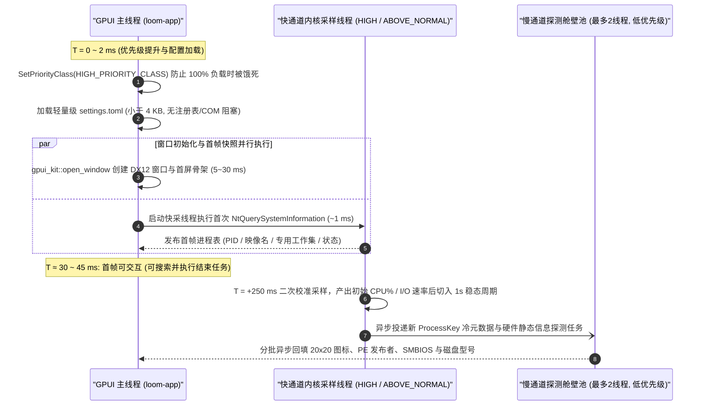
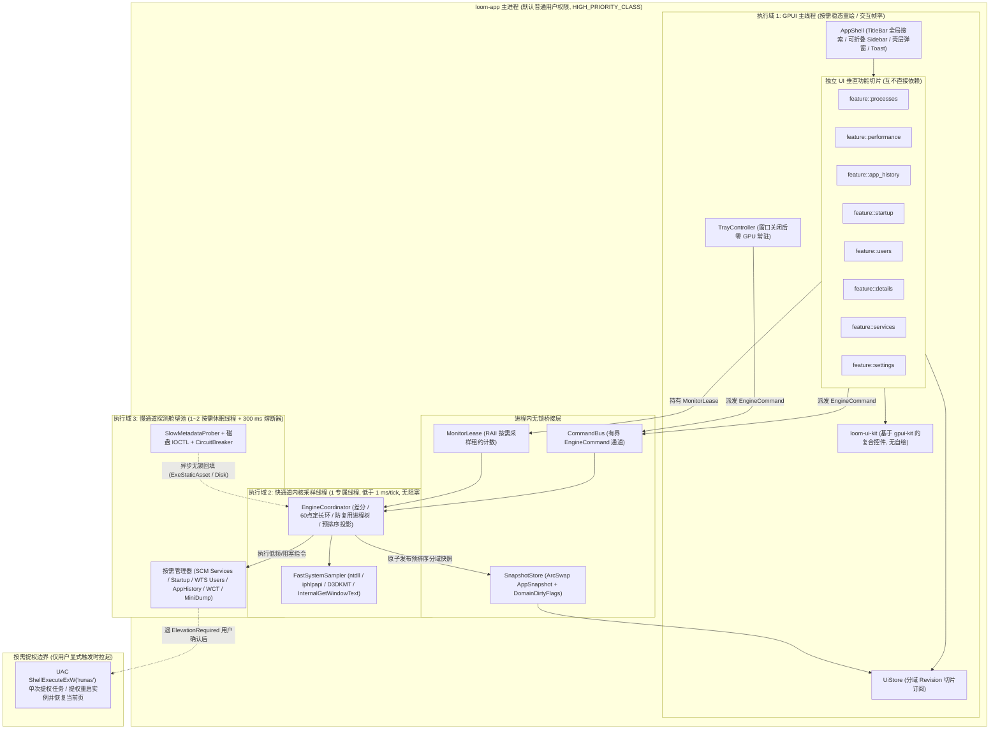
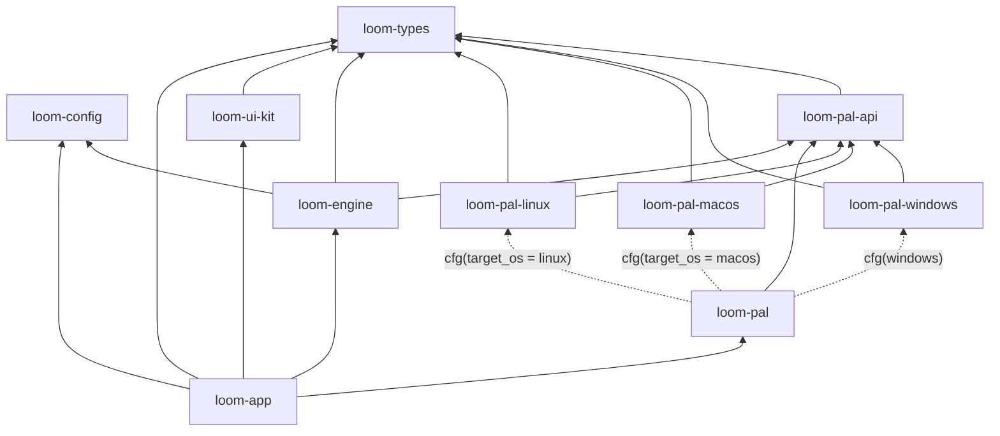

# 系统架构

[English](architecture.md) | 中文

Loom 是一款基于 **Rust** 与 **GPUI Kit (`gpui-kit` / `gpui-component`)** 构建的跨平台（Windows / macOS / Linux）原生桌面任务管理器。当前阶段聚焦 **Windows** 平台实现，在对齐 Windows 11 自带任务管理器核心功能的基础上，重点解决**冷启动慢、高负载卡顿以及未响应窗口或慢速外置盘导致的启动阻塞**问题，并通过编译期静态平台抽象层（PAL）为后续扩展 Linux 与 macOS 后端提供清晰契约。

<a id="core-architectural-principles"></a>

## 1. 核心架构原则

1. **后端无头化与无重型运行时（Headless & Runtime-Free Core）**：系统采样、差分计算、进程树构建、搜索排序索引与管控命令调度均放在无 UI 依赖的 `loom-engine` 及更底层 Crate 中，不引入多线程 `tokio` 运行时，避免在高核数 CPU（如 32 逻辑核）启动时派生大量空闲工作线程。
2. **编译期静态平台抽象（Zero-Cost Static PAL）**：Windows、macOS、Linux 后端分别独立成 Crate，通过关联类型（Associated Types）、零大小扩展类型（ZST）与 `loom-pal` 的 `#[cfg(target_os)]` 静态类型别名完成单态化绑定，热路径避免虚表（`dyn Trait`）与装箱 Future。
3. **快慢双通道舱壁隔离（Dual-Lane Bulkhead Isolation）**：将亚毫秒级纯内存态内核调用（快通道）与可能发生磁盘、Shell 或驱动阻塞的元数据探测（慢通道）隔离，配合 `300 ms` 设备级超时熔断器，降低启动与运行期卡死风险。
4. **冷热数据分离与缓冲区复用**：以 `(pid, create_time_100ns)` 复合键标识进程生命周期；高频热指标使用 `Copy` 值结构覆写复用缓冲区，低频冷元数据（图标、PE 发布者、命令行）按路径二级共享缓存并仅解析一次。
5. **UI 垂直功能切片与组件组合**：`loom-app` 按 `shell` + `features/*` 切片组织，直接组合 `gpui-kit` 现成控件（`Table`、`AreaChart`、`LineChart`、`Sidebar`、`TitleBar`、`Dialog`、`PopupMenu`、`Tree`、`Select`）与 Flexbox 布局，避免根视图全局大状态、全局弹窗大枚举以及手写自定义 `Canvas`/Shader。
6. **分域只读快照、事件驱动唤醒与按需监控租约（RAII `MonitorLease`）**：通过 `ArcSwap<AppSnapshot>` 配合单调递增的分域 `Revision` 与零轮询 `SnapshotWakeSignal` 推送唤醒 `UiStore`；按需管理域（服务、启动应用、用户、应用历史、多核网格、管理员专属 `ProcessNetwork` ETW）通过 RAII `MonitorLease` 引用计数按需激活，离开页面或最小化窗口时自动停采或降频。
7. **普通权限启动与按需提权**：默认以普通用户权限启动，避免冷启动阶段弹出 UAC 确认框；仅在操作高完整性进程、启停系统服务或勾选以管理员运行新任务时触发 `runas` 或提权重启恢复当前视图。

<a id="performance-budgets-and-anti-hang-architecture"></a>

## 2. 性能预算与防卡死架构

### 2.1 性能与资源预算

以现代多核桌面环境（16 核 32 逻辑处理器、400+ 进程、10,000+ 线程）为基准设定工程预算：

| 指标维度 | Loom 工程预算 | 原生 Windows 11 任务管理器常见问题 |
| :--- | :--- | :--- |
| **冷启动首帧可交互时间** | **`< 50 ms`**（启动提升优先级，`< 35 ms` 渲染首屏进程表） | XAML Islands / WMI / COM 同步初始化常耗时 `800 ~ 3000+ ms` |
| **异常环境抗阻塞能力** | **慢 I/O 舱壁隔离 + `300 ms` 熔断旁路** | 遇未响应窗口、休眠机械盘、异常 U 盘或断连网络盘时容易白屏或阻塞 |
| **稳态后台 CPU 占用（1s 周期）** | **`< 0.15%`**（单次内核扫描 + 差分 `< 1 ms`） | 常达 `0.8% ~ 3%+`，展开多核网格或高频滚动时升高 |
| **静止与最小化 GPU 占用** | **按刷新周期按需重绘（默认 1s 时约 `1 FPS`）；最小化 / 关窗托盘 `0% GPU`** | 跨框架合成桥接开销较高，最小化仍存在后台布局计算 |
| **私有工作集内存（Private WS）** | **`30 ~ 45 MB`**（上限 `< 45 MB`；复用 Scratch 缓冲 + `20×20` 图标缓存） | 常见占用 `80 ~ 160+ MB` |
| **自身系统线程总数** | **`6 ~ 8` 个系统线程以内** | 常见派生 `30 ~ 60+` 个线程池、COM 与性能计数器线程 |

### 2.2 渐进式冷启动管线（`< 50 ms` 目标）



### 2.3 Windows 六项防卡死约束

1. **不依赖 WMI 与 PDH**：不调用 `IWbemServices`（跨进程 RPC 至 `Winmgmt`）与 `PdhOpenQuery`（加载第三方性能计数器 DLL 并争抢全局注册表锁）。CPU/进程调用 `ntdll`，网卡调用 `iphlpapi`，磁盘调用带隔离保护的 `IOCTL`，GPU 调用 `DXGI + gdi32!D3DKMT`，内存频率与插槽直接解析 `GetSystemFirmwareTable('RSMB')` 原始 SMBIOS 表（`< 0.05 ms`）。
2. **不跨进程发送同步窗口消息**：不调用 `GetWindowTextW` 或阻塞式 `SendMessageW`（桌面上存在未响应程序时可能长时间阻塞调用线程）。统一使用 `InternalGetWindowText` 与非阻塞 `IsHungAppWindow`。
3. **慢速磁盘、安全弹出与断连网络盘舱壁熔断**：对 UNC 路径或 `DRIVE_REMOTE` 网络映射盘跳过打开远程文件提取图标/签名，退回 `SHGFI_USEFILEATTRIBUTES` 内存级扩展名图标；对存储控制器驱动实施白名单校验（`stornvme`、`storahci`、`atapi`），对机械盘增加活动变化守卫避免空转唤醒，并通过 `CM_Register_Notification`（`DEVICEQUERYREMOVE`）配合 USB 安全弹出；磁盘静态属性与卷映射（`IOCTL_STORAGE_QUERY_PROPERTY`、`IOCTL_VOLUME_GET_VOLUME_DISK_EXTENTS`）、每设备 `IOCTL_DISK_PERFORMANCE` 采样、Restart Manager 文件占用查询以及 Shell 图标/PE 版本读取均隔离在慢通道舱壁池中，单次探测超过 `300 ms` 触发设备级 `CircuitBreaker` 冷却 60 秒并旁路跳过，避免阻塞快通道。
4. **不使用 `ReadProcessMemory` 跨进程读目标 PEB**：进程命令行统一通过 `NtQueryInformationProcess(ProcessCommandLineInformation)` 获取，规避目标进程挂起或换页锁导致的等待。
5. **发布者解析不触发外网吊销检查**：优先读取本地 PE `VersionInfo`（`CompanyName` / `FileDescription`）；若校验 Authenticode 签名，附加 `WTD_CACHE_ONLY_URL_RETRIEVAL` 避免发起 CRL/OCSP 网络请求。
6. **不长期持有目标进程句柄**：大部分动态指标直接取自 `SystemProcessInformation` 缓冲；按需打开 `PROCESS_QUERY_LIMITED_INFORMATION` 后立即 `CloseHandle`，避免句柄泄漏与目录占用。

<a id="system-topology-and-execution-domains"></a>

## 3. 系统拓扑与执行域边界

系统在单一用户态主进程内划分为 **三个隔离的执行域**，按需提权操作通过独立的系统 Shell 提权边界完成：



<a id="workspace-module-layout-and-dependency-dag"></a>

## 4. Workspace 模块划分与依赖拓扑

通过 10-Crate Cargo Workspace 在编译期约束单向依赖 DAG：



### 各 Crate 职责与边界

| Crate | 类型 | 核心职责 | 依赖约束与边界 |
| :--- | :--- | :--- | :--- |
| `loom-types` | lib | 跨平台紧凑领域模型（`ProcessKey`、`ProcessHotSample`、`ProcessColdMeta`、缺口感知 `HistoryRing`/`ThroughputRing`、`CpuCoreKind`、`d3_asleep`、`ProcessSocketRecord`、`FileLockHolder`、`LeakWarning`、`WebView2Role`、`TaskManagerReplacementStatus`、`AdminStartupStatus`、五大硬件快照、服务/启动项/用户/历史记录、`CapabilityFlags`） | 无 OS 依赖、无 UI 依赖；高频热结构使用 `Copy` 紧凑内存布局 |
| `loom-config` | lib | 本地配置持久化（`settings.toml`：启动页、刷新周期、主题、语言、窗口几何、置顶/托盘行为、列偏好、全局热键、增量 v1 进程与诊断开关）、冻结的 `v1`（`CONFIG_CONTRACT_VERSION = "1.0"`）向前迁移与原子落盘 | 同步加载目标 `< 1 ms`，不依赖平台后端或 UI；忽略未知未来可选键并结构化拒绝更高 `schema_version` |
| `loom-pal-api` | lib | 冻结的 `v1`（`PAL_API_CONTRACT_VERSION = 1`）静态平台抽象 Trait 族（`PlatformBackend`、`FastSystemSampler`、`SlowMetadataProber`、`ServiceManager`、`StartupManager`、`SessionManager`、`AppHistoryReader`、`SystemOperator`，并仅以默认实现扩展挂起/恢复、重启资源管理器、文件占用查询、监听端口、管理员 ETW 门控、系统任务管理器替换与常驻管理员启动）、调用方复用缓冲 `SampleScratch` 与 `PalError` | 仅依赖 `loom-types`，不暴露特定操作系统句柄或头文件类型 |
| `loom-pal-windows` | lib | Windows 采集与系统控制实现（`ntdll` Idle-Cycle CPU 与 `ProcessSequenceNumber`、纯 `D3DKMT` 每进程 GPU 与 `D3` 电源门控、防护 `IOCTL`、`SMBIOS`、`SCM`、`WTS`、`WCT`、`MiniDump`、`iphlpapi` 端口、Restart Manager 文件占用、管理员专属 ETW 进程网络，以及 IFEO 系统任务管理器替换、Task Scheduler 常驻管理员启动与跨 UIPI 单实例唤醒） | 仅 `cfg(windows)` 编译；采用 `windows-sys`，内部收敛 `unsafe` FFI，遵守六项防卡死约束 |
| `loom-pal-macos` | lib | macOS 后端预留骨架（`Mach` / `libproc` / `IOKit` / `launchd` 映射位） | 仅 `cfg(target_os = "macos")` 编译；当前提供编译期契约占位桩，计划于 `0.3.0` 实现 |
| `loom-pal-linux` | lib | Linux 后端预留骨架（`procfs` / `sysfs` / `netlink` / `drm` / `systemd` 映射位） | 仅 `cfg(target_os = "linux")` 编译；当前提供编译期契约占位桩，计划于 `0.2.0` 实现 |
| `loom-pal` | lib | 平台编译期静态门面（导出 `pub type NativeBackend = ...`）及跨平台单实例锁、系统托盘与电源/显示状态适配 | 消除上层代码中的 `#[cfg(target_os)]` 分支，无虚表动态包装 |
| `loom-engine` | lib | 无头采样与业务编排引擎（`EngineCoordinator<B>`、`SnapshotWakeSignal` 推送唤醒、差分计算、缺口感知 60 点定长环、防复用进程树、结构化搜索与按需 `:PORT`、行序与按住 `Ctrl` 冻结、默认开启的传递性安全排序迟滞（Sort Deadband）、可复用 `ProjectionScratch`、WebView2 宿主归因、零系统调用泄漏预警、全表格预排序视图投影、`MonitorLease`） | 禁止依赖 GPUI Crate 或多线程 Tokio；支持注入 `MockBackend` 进行无头基准与故障注入测试 |
| `loom-ui-kit` | lib | 基于 `gpui-kit` 的薄组合层：WCAG 2.1 对比度校验语义色与按主题缓存（`CachedSemanticColors`）、统一等宽数字快速整形（`MetricDisplay` / 静态查找表）、有界行文本缓存（`RowTextCache`）、热力图单元格、单行预览截断、缺口感知微缩波形卡片、阶梯坐标上限、自适应多核网格求解器（`8%` 迟滞）、活跃 GPU 引擎优选、打开期稳定排序、防公式注入 CSV 导出、内存四段条与 `rust-i18n` 辅助 | 隔离上游 `gpui-kit` 细节，无自定义 `Canvas`/Shader 绘制，不持有业务领域状态 |
| `loom-app` | bin | 桌面组合根与垂直功能切片 UI：入口优先级提升、渐进启动管线、`AppShell` 与 8 个独立 `features/*` 模块 | 各 `feature` 模块不互相 import 内部实现，跨页导航（`转到详细信息` / `转到服务`）经由 `ShellHandle` 与 `NavigationIntent` 完成 |

<a id="feature-sliced-ui-architecture"></a>

## 5. UI 层模块化架构（`loom-app` & `loom-ui-kit`）

```text
crates/loom-app/src/
├── main.rs                  # 入口：HIGH_PRIORITY_CLASS 提升、单实例唤醒、组合根启动
├── bootstrap.rs             # 配置加载 + EngineCoordinator<NativeBackend> + GPUI 窗口并行拉起
├── bridge/
│   ├── store.rs             # UiStore：按域持有 Arc<*Slice> 与 Revision 增量订阅
│   ├── commands.rs          # EngineCommand 派发与权限拦截反馈 (ElevationRequired -> 提权通知)
│   └── monitor_lease.rs     # RAII MonitorLease 封装（视图卸载或最小化自动释放按需采样）
├── shell/
│   ├── window.rs            # Root 包裹的主窗口（TitleBar 搜索栏 + 可折叠 Sidebar + 页面出口）
│   ├── nav.rs               # 声明式路由表与跨页定位总线 (JumpToDetails / JumpToServices)
│   ├── dialogs.rs           # 仅放置跨页通用壳层弹窗（运行新任务 / 通用确认）
│   └── tray.rs              # 托盘常驻控制器（关窗销毁 GPUI 窗口释放显存）
└── features/                # 8 个独立垂直功能切片，互不直接依赖
    ├── processes/           # 进程页（三段分类视图 / 父子进程树切换 + 热力图表格 + 右键菜单）
    ├── performance/         # 性能页（左微缩波形栏 + 右 CPU/内存/磁盘/网络/GPU 子视图）
    ├── app_history/         # 应用历史记录页（累计资源表 + 清空历史）
    ├── startup/             # 启动应用页（上次 BIOS 耗时 + 启用/禁用管理）
    ├── users/               # 用户页（会话级聚合行 + 可展开会话进程树 + 断开连接）
    ├── details/             # 详细信息页（全字段虚拟化表/树 + 局部相关性/等待链弹窗 + 菜单）
    ├── services/            # 服务页（SCM 服务表 + 启停重启工具栏 + 进程联动）
    └── settings/            # 设置页（启动页 / 刷新速度 / 窗口置顶与托盘 / 主题与语言）
```

特定功能弹窗（如 `features/details/` 中的「设置相关性」与「分析等待链」）保留在各自功能切片内，通过 `gpui-kit` 的 `Root` 弹窗层挂载，不在 `shell/` 中维护全局弹窗大枚举。

### 5.1 分域只读快照与预计算视图投影

`AppSnapshot` 拆分为独立的 `Arc` 子切片，并在 `loom-engine` 后台线程完成排序、搜索过滤与树展开扁平化：

- `processes: Arc<ProcessTableSlice>`（已按当前排序列、搜索词与展开态扁平化的 `Vec<ProcessRowProjection>`，选中态与右键菜单锚定 `ProcessKey`，避免行重排导致误操作；支持 `MonitorDomain::Processes` RAII 租约门控，在桌面应用切离进程页且托盘速览未打开时跳过每拍进程表投影；`ProjectionEngine` 绑定 `PlatformBackend::PLATFORM`，仅在 `PlatformKind::Windows` 分组视图下启用对齐任务管理器的壳层解嵌套与多进程应用聚合，不影响 Linux/macOS 分组与通用 `Process Tree`）
- `details: Arc<DetailsTableSlice>`（仅在 `Details` 页激活持有租约时构建投影）
- `performance: Arc<PerformanceSlice>`（五大类硬件摘要、60 点定长量化历史环与设备元数据）
- `services: Arc<ServicesSlice>` / `startup: Arc<StartupSlice>` / `users: Arc<UsersSlice>` / `app_history: Arc<AppHistorySlice>`（均受 `MonitorLease` 门控，未查看时无后台轮询与投影开销；激活时同样在引擎后台线程完成过滤、施瓦茨排序与 `Users` 会话树扁平化投影，消除 UI 主线程排序过滤抖动）
- `settings: Arc<SettingsSlice>`（当前生效配置的只读投影）

**引擎侧与渲染热路径分层优化**：

- **引擎投影稳定性与低分配**：默认开启传递性安全的 **排序微抖动迟滞（Sort Deadband）**（CPU/GPU `< 0.2%`、磁盘/网络 `< 16 KiB/s` 在排序前以 `O(N)` 预计算稠密迟滞键 `ProjectionScratch::dense_deadband`，冻结排序同理预计算 `dense_frozen_ranks`，排序比较阶段纯 `O(1)` 索引零哈希查询）；直接复用协调器已解析的 `ParsedQuery` 消除每拍重复词法解析；对 `Details` 静态排序列按进程键签名与 `ColdMetaCache::version` 缓存有序索引跳过稳态 `O(N log N)` 字符串比较；单行构建合并冷缓存查询与 `O(1)` 父索引读取；冷元数据批量回填通过短窗口（默认 `40 ms`）合并发布避免启动期投影风暴；配合跨帧复用缓冲 `ProjectionScratch`（含冲突安全的 `HashGroupIndex` 与 `FoldedKeyArena`）及 `ColdMetaCache` 预计算（`webview2_role`、`webview2_host_exe`、`user_name_short`）。
- **UI 渲染管线与 `gpui-fast` 协同**：`loom-app` 启用 `gpui-kit` 的 `gpui-fast` 渲染后端（保留子树与局部 Splice、Taffy 布局节点跨帧复用、`NumberShaping` 数字快速整形、GPU Scroll Layers 瓦片缓存与 D3D11 状态去重），并将静态页面工具栏与高频刷新的二维虚拟化 `DataTable`（`Entity<TableState<D>>`）解耦。表体渲染通过以下机制消除热路径分配与无效重绘：
  - 按主题/版本缓存 19 项 WCAG 语义色（`CachedSemanticColors`）、表头本地化字符串（`*LocaleCache`）与分组标题计数字符串；
  - 指标与热力图列统一使用等宽字体（`mono_font_family`）+ `MetricDisplay`（数值部分严格限定在 `gpui-fast::NumberShaping` 字符集内，辅以静态查找表与有界 `RowTextCache`，零热力级别跳过冗余圆角与透明背景样式）；
  - `CommandLine`/`ExePath` 等长文本列在单元格渲染层按 256 字符做单行安全截断，且仅在内容可能超出列宽截断时按需挂载 `Stateful` ID 与 `Tooltip`（复制与 CSV 导出始终保留完整文本）；纯文本单元格与无徽章名称列压平多余容器嵌套以减少 Taffy 布局节点；
  - 表级单一右键捕获结合 `TableColumnLayout::column_index_at_x` 动态定位点击列（替代逐单元格事件监听器）、轻量折叠箭头、空状态微章短路、独立表头排序暂停徽章 Entity（悬停冻结切换不触发整表重绘）与条件化 `a11y` 拼接；
  - 基于 `visible_rows_changed`/`visible_columns_changed` 与 `ViewportFingerprint` 的视口脏检查（程序选中重锚定不自清指纹）、`O(1)` 选中行重锚定，以及 `ScrollBurstCoalescer`（`150 ms` 静默防抖 / `500 ms` 强制上限，用户主动操作立即旁路）在快速滚动期间保护 `gpui-fast` GPU Scroll Layers 瓦片命中。GPUI 主线程在 `TableDelegate::render_td` 中仅对视口可见行与可见列做 `O(1)` 索引读取（目标 UI 线程单帧 `< 0.5 ms`，交互滚动稳跑 `120 FPS`）。

### 5.2 `gpui-kit` 组件映射

| 界面区域 / 视觉元素 | 选用的 `gpui-kit` (`gpui-component`) 控件 | 组合实现方式（无自定义绘制） |
| :--- | :--- | :--- |
| **窗口顶栏与全局搜索** | `Root` + `TitleBar` + `Input` | 居中搜索框支持结构化语法（`,` 或、空格与、`!`/`-` 取反、`pid:`、`user:`、`cpu:`、`mem:`、`status:`、按需 `:PORT`）与键盘快捷键（`Ctrl+F`、`Ctrl+1..8`、`F5`、`Space`、按住 `Ctrl` 临时冻结） |
| **左侧导航与底部设置** | `Sidebar`、`SidebarMenu`、`SidebarMenuItem`、`SidebarFooter` | 汉堡按钮控制 `.collapsed(bool)` 展开/图标态，底部固定「设置」 |
| **虚拟化业务表格与树表** | `DataTable` + `TableState<D>` + `TableDelegate` | 首列左固定（`fixed_left`）组合 `h_flex().pl(px(depth * 16.))` + 轻量折叠箭头 + 降采样 `Img`；指标列统一等宽字体（`NumberShaping` 友好）；滚动列双向虚拟化与视口脏检查 + 滚动突发合并；默认排序迟滞 + 悬停暂停排序防跳行；防公式注入 UTF-8 BOM CSV 导出；WebView2 宿主归因与零系统调用泄漏预警标识；表级单一右键菜单与坐标列命中 |
| **多级右键菜单** | `PopupMenu` / `.context_menu(...)` | 支持勾选标记（`✓ 效能模式`）、挂起/恢复、重启资源管理器、文件占用查找、复制摘要、分隔线与二级子菜单（`设置优先级 >`、`资源值 >`） |
| **性能页左栏设备微缩波形图** | `v_virtual_list` + `AreaChart` | 缺口感知 `AreaChart` 卡片，磁盘/网卡保持打开期稳定排序（`merge_stable_order`）、阶梯网卡坐标与诚实的「休眠 (D3)」/ `—` GPU 读数 |
| **CPU 总体+内核双层图 & 多核网格** | 多序列 `AreaChart` + 自适应网格容器 | 双 `.y(...)` 渲染总利用率与内核时间渐变；自适应逻辑核网格（`compute_core_grid_layout`，`8%` 缩放迟滞与 `Full`/`Short`/`Hidden` 渐进标题）按 `P`/`E`/`LP-E` 异构着色 |
| **磁盘双图 / 网卡吞吐 / GPU 多引擎** | `AreaChart` / `LineChart` + `Select` | 阶梯纵轴上限（`stepped_throughput_ceiling` / `stepped_network_ceiling`）消除抖动；GPU `2×2` 网格按 `>= 1%` 峰值自动优选活跃引擎（`select_active_gpu_engines`）并尊重用户 `Select` 覆盖 |
| **内存组成四段比例条** | `h_flex` + `relative(ratio)` + `Tooltip` | Flexbox 相对宽度色块拼接「使用中 / 已修改 / 备用 / 可用」，每段挂载 `Tooltip` |
| **运行新任务 / 相关性 / 等待链 / 文件占用 / 托盘** | `Dialog`、`Input`、`Checkbox`、`Tree`、`Notification` | 等待链阻塞树使用 `Tree`；Restart Manager 文件占用弹窗列出锁持有进程；`ElevationRequired` 弹出提权 `Notification`；`0%` GPU 托盘速览浮窗无需打开主窗口即可查看 CPU/内存与高占用进程 |

<a id="core-backend-subsystems"></a>

## 6. 核心后端子系统设计

### 6.1 防 PID 复用进程树与进程树终止 (`loom-engine` & `loom-pal-windows`)

Windows 内核会高频复用已退出进程的 `PID`。Loom 统一使用 `ProcessKey { pid, create_time_100ns }`：

- **父子关系校验**：仅当父进程存在且满足 `parent.create_time_100ns <= child.create_time_100ns` 时才挂载为子节点，否则提升为根级节点，避免伪父子环路与缓存串号。
- **自底向上结束进程树（`KillProcessTree`）**：按校验后的 `ProcessKey` 子树收集后代，先挂起或自叶向根依次终止，避免守护型父进程在退出过程中重新拉起子进程。
- **二级冷资产去重缓存**：`ProcessKey -> Arc<ProcessColdMeta> -> Arc<ExeStaticAsset>`（按规范化路径索引）。提取 EXE 图标后缩放到 `20×20` RGBA8（单图标约 `1.6 KB`）并释放原始大图句柄，多进程应用共享同一份静态资产。

### 6.2 无 WMI/PDH 五大硬件实时采样 (`loom-pal-windows::performance`)

- **CPU**：优先使用 `NtQuerySystemInformationEx(SystemProcessorIdleCycleTimeInformation)` 配合 QPC 校验的处理器组周期基线（不可用时平滑退回 `SystemProcessorPerformanceInformation`）；`GetLogicalProcessorInformationEx` 启动缓存插槽、物理核、NUMA、L1/L2/L3 缓存并基于 `EfficiencyClass` 与 L3 共享识别异构 `P`/`E`/`LP-E` 核心拓扑；`CallNtPowerInformation` 计算实时主频（GHz）。
- **内存**：`GlobalMemoryStatusEx` + `GetPerformanceInfo` + `SystemMemoryListInformation` 获取内存组成；解析 `GetSystemFirmwareTable('RSMB')` 获取内存频率（MT/s）、插槽数与外形规格。
- **磁盘**：通过 `IOCTL_VOLUME_GET_VOLUME_DISK_EXTENTS` 建立物理盘与盘符映射（如 `磁盘 0 (C: D:)`），`IOCTL_STORAGE_QUERY_PROPERTY` 识别 NVMe / SATA SSD / HDD 与型号，`IOCTL_DISK_PERFORMANCE` 读取活动时间、读写速率与平均响应延迟，并具备 `checked_sub` 计数回绕防护、PnP 驱动白名单、机械盘活动守卫、`CM_Register_Notification` 安全弹出配合与 `300 ms` 设备级熔断保护。
- **网络**：`GetIfTable2` + `GetAdaptersAddresses` 采集 64 位收发字节计数（`checked_sub` 回绕防护）、链路速率、连接类型（以太网 / Wi-Fi）及 IPv4/IPv6/DNS；按需 `iphlpapi`（`GetExtendedTcpTable` / `GetExtendedUdpTable`）支撑 `:PORT` 监听端口搜索；可选管理员专属单线程 ETW 采集器（`Microsoft-Windows-Kernel-Network`，受 `MonitorDomain::ProcessNetwork` 租约门控）在按需启用时提供每进程网络吞吐。
- **GPU**：厂商中立的 `DXGI` + 纯内核态 `gdi32!D3DKMTQueryStatistics` 采集各 Node 引擎（`3D`、`Copy`、`Video Encode`、`Video Decode` 等）时间片差分与全局及每进程专享/共享显存和 GPU 利用率；`GpuPowerGate`（`cfgmgr32.dll` `DEVPKEY_Device_PowerData`）对处于 `D1`–`D3` 休眠态的混合独显跳过 `KMTQAITYPE_ADAPTERPERFDATA`（诚实回报 `d3_asleep` 与 `—` 温度而不唤醒独显），并对空闲 `D0` 适配器的性能查询限频至 `20 s`。
- **缺口感知历史环与进程诊断**：`HistoryRing<N>` 与 `ThroughputRing<N>` 在暂停恢复、采样异常或时钟跳变（`> max(interval * 3, 5 s)`）时写入 `GAP_SENTINEL` 断档标记且保持 `Copy` 内存布局不变；`ProcessSequenceNumber`（`NtQueryInformationProcess` class `92`）进一步加固 PID 复用防护；`rstrtmgr.dll` 提供 Restart Manager 文件占用排查；零系统调用的 `webview2.rs` 与 `leaks.rs` 实现 WebView2 宿主归因与句柄/子进程/孤儿泄漏预警。
- **Windows IFEO 系统任务管理器替换与跨 UIPI 单实例唤醒（`loom-pal-windows::taskmgr`）**：通过 `HKLM\SOFTWARE\Microsoft\Windows NT\CurrentVersion\Image File Execution Options\taskmgr.exe` 的 `Debugger`（`REG_SZ`）将 `taskmgr.exe` 重定向至 `"<loom-app.exe>" --task-manager`；启用前检查冲突（拒绝覆盖已有 `Debugger`、`UseFilter` 或任意子项）、执行普通与调试脱离双探针自检，并在 `%ProgramData%\Loom\taskmgr-recovery.json` 维护 `Prepared → Active → Restoring → Restored` 持久化恢复日志及 `taskmgr-recovery.txt` 应急恢复说明（普通权限切换时按需经 `ShellExecuteExW("runas")` 拉起短期维护助手执行，无需先重启主窗口）。`--task-manager` 入口按授权账户 SID 校验，提权态通过 `GetShellWindow()` + `PROC_THREAD_ATTRIBUTE_PARENT_PROCESS`（继承桌面壳层标准令牌并重建用户环境变量）降权拉起界面，配合 `ready`/`commit`/`done` 三事件与零数据前景命名管道（`AllowSetForegroundWindow`）完成就绪握手与跨 UIPI `WM_COPYDATA` 单实例唤醒；任一步失败或用户临时打开原生任务管理器时，使用 `DEBUG_ONLY_THIS_PROCESS | CREATE_SUSPENDED` → `DebugSetProcessKillOnExit(false)` → `DebugActiveProcessStop` → `ResumeThread` 绕过 IFEO 启动 `%SystemRoot%\System32\taskmgr.exe`，并通过 `Local\Loom.Taskmgr.Native.<PID>` 事件与持有父句柄处理 `taskmgr.exe` `autoElevate` 提权二次自启交接，防止回环与锁死。
- **Windows Task Scheduler 常驻管理员启动（`loom-pal-windows::admin`）**：面向管理员组账户提供可选的免重复 UAC 提权启动链路。开启时经一次按需 UAC 维护助手（`--loom-admin-manage`）通过原生 Task Scheduler 2.0 COM 接口（零额外外部依赖，直接基于 `windows-sys` 调用 `ITaskService`/`ITaskFolder`/`IRegisteredTask`）为当前账户 SID 注册按需计划任务 `Loom.Admin.<SID>`（`InteractiveToken`、`HighestAvailable`、`Priority=4`、不存密码，SDDL 仅向当前用户授予读与执行 `FRFX`，由 SYSTEM/Administrators 独占写权限），并在 `%ProgramData%\Loom\admin\<SID>\grant.toml` 记录已授权可执行文件路径。冷启动（含 IFEO 替换 `Ctrl+Shift+Esc` 触发的 `--loom-taskmgr-entry` 启动）在单实例锁与窗口初始化前通过 `admin::route` 创建仅当前用户可访问的 `Local\Loom.Admin.<nonce>.{ready,commit,done}` 三事件并调用 `IRegisteredTask::RunEx` 传入十六进制票据（`$(Arg0)`），提权代理（`--loom-admin-run`）严格校验调用方 PID/创建时间/同会话/同 SID/非沙箱/Medium+ 完整性并等待旧实例完全退出后再拉起管理员态界面并透传任务管理器握手参数，窗口就绪后置位 `done`（超时或失败自动降权回退 `--loom-admin-fallback`）。在设置页开启或关闭该选项时，自动通过提权代理或 `standard_spawn` 降权代理完成无缝权限切换并恢复至设置页。

### 6.3 跨平台归一化映射（面向 `0.2.0` Linux 与 `0.3.0` macOS）

| 统一抽象概念 (`loom-types`) | Windows (`loom-pal-windows`) | Linux (`loom-pal-linux`, `0.2.0`) | macOS (`loom-pal-macos`, `0.3.0`) |
| :--- | :--- | :--- | :--- |
| **生命周期主键 `ProcessKey`** | `(PID, CreateTime FILETIME)` | `(pid_t, /proc/[pid]/stat starttime)` | `(pid_t, pbi_start_tvsec)` |
| **效能/节能模式 (`EcoMode`)** | `EcoQoS` (`PROCESS_POWER_THROTTLING`) | `SCHED_IDLE` / `nice` / cgroup weight | Task QoS / App Nap |
| **系统服务 (`ServiceRecord`)** | Windows SCM (`EnumServicesStatusExW`) | `systemd` D-Bus Units | `launchd` Daemons & Agents |
| **启动应用 (`StartupEntry`)** | 注册表 `Run`/`StartupApproved` + 启动目录 + UWP/MSIX `StartupTask`（解析 PE 描述、`AppxManifest.xml` + `SHLoadIndirectString` 与 DPI 匹配原生 RGBA 图标） | XDG Autostart (`~/.config/autostart/*.desktop`) | `SMAppService` / `LaunchAgents` |
| **用户会话 (`UserSession`)** | WTS (`WTSEnumerateSessionsW`) | `systemd-logind` Sessions | `utmpx` / Console User |
| **虚拟化/沙箱列** | UAC 虚拟化 (`TokenVirtualizationEnabled`) | Namespace / Flatpak / Snap | App Sandbox Entitlements |
| **等待链诊断 (`WaitChain`)** | Win32 WCT (`GetThreadWaitChain`) | `/proc/[pid]/task/[tid]/wchan` | `proc_pidinfo` Thread `wchan` |
| **按需管理员提权** | `ShellExecuteExW("runas")` | `pkexec` / Polkit Agent | Authorization Services |

<a id="core-extension-contracts"></a>

## 7. 核心静态扩展契约

自 Loom `0.1.0` 起，以下两项契约边界正式冻结并由确定性单元测试守卫：

- **`loom-pal-api`（`PAL_API_CONTRACT_VERSION = 1`）**：冻结 8 个零开销静态分派 PAL Trait（`PlatformBackend`、`FastSystemSampler`、`SlowMetadataProber`、`ServiceManager`、`StartupManager`、`SessionManager`、`AppHistoryReader`、`SystemOperator`）、关联类型与线程安全约束、热样本结构的 `Copy` 布局约束（`ProcessKey`、`ProcessHotSample<()>`、`SystemPerfSample`）以及调用方复用缓冲（`ProcessSampleScratch`、`PerfSampleScratch`），为 `loom-pal-windows` 与后续 `0.2.0`（`loom-pal-linux`）、`0.3.0`（`loom-pal-macos`）提供稳定接口边界。
- **`loom-config`（`CONFIG_CONTRACT_VERSION = "1.0"`，`CURRENT_SCHEMA_VERSION = 1`）**：冻结 `settings.toml` v1 配置向前迁移保障——历史/部分 v0 配置可平滑迁移至 v1，未知未来可选键会被安全忽略（不启用 `deny_unknown_fields`），高于当前支持版本的 `schema_version`（如 `2`）会结构化返回 `ConfigError::UnsupportedSchemaVersion`。

```rust
// crates/loom-pal-api: 冻结的 v1 编译期单态化平台后端总契约（无虚表、无装箱 Future）
pub const PAL_API_CONTRACT_VERSION: u32 = 1;

pub trait PlatformBackend: Send + Sync + 'static {
    /// 平台专属紧凑进程扩展字段（Copy 语义；无需扩展的平台设为 `()` 占 0 字节）
    type ProcessExt: Copy + Default + Send + Sync + 'static;

    type FastSampler: FastSystemSampler<Ext = Self::ProcessExt>;
    type SlowProber: SlowMetadataProber;
    type ServiceMgr: ServiceManager;
    type StartupMgr: StartupManager;
    type SessionMgr: SessionManager;
    type HistoryReader: AppHistoryReader;
    type Operator: SystemOperator;

    /// 静态平台身份画像（`Windows` / `Linux` / `macOS`）
    const PLATFORM: PlatformProfile;

    /// 编译期静态能力位图：用于消除当前平台不支持的 UI/控制分支
    const CAPABILITIES: CapabilityFlags;

    /// 进程入口优先级提升
    fn boost_self_priority();

    /// 宿主主窗口置顶与恢复钩子（无头或未实现平台默认空操作）
    fn set_main_window_always_on_top(_enabled: bool) {}
    fn is_main_window_minimized() -> bool { false }
    fn restore_and_focus_main_window() {}

    fn initialize() -> Result<Self, PalError>
    where
        Self: Sized;
}

// crates/loom-pal-api: 快通道采样契约（仅限纯内存态内核调用，复用 SampleScratch 避免逐周期堆分配）
pub trait FastSystemSampler: Send {
    type Ext: Copy + Default + Send + Sync + 'static;

    fn sample_processes(
        &mut self,
        scratch: &mut ProcessSampleScratch<Self::Ext>,
    ) -> Result<Timestamp100Ns, PalError>;

    fn sample_performance(
        &mut self,
        scratch: &mut PerfSampleScratch,
    ) -> Result<Timestamp100Ns, PalError>;
}

// crates/loom-pal-api: 系统管控与诊断契约（统一结构化返回 ElevationRequired）
pub trait SystemOperator: Send + Sync {
    fn run_new_task(&self, req: &RunTaskRequest) -> Result<Option<u32>, PalError>;
    fn terminate_process(&self, key: ProcessKey) -> Result<(), PalError>;
    fn terminate_process_tree(&self, targets: &[ProcessKey]) -> Result<TreeKillReport, PalError>;
    fn set_efficiency_mode(&self, key: ProcessKey, enabled: bool) -> Result<(), PalError>;
    fn set_priority(&self, key: ProcessKey, priority: ProcessPriority) -> Result<(), PalError>;
    fn set_affinity(&self, key: ProcessKey, mask: &CpuAffinityMask) -> Result<(), PalError>;
    fn set_uac_virtualization(&self, key: ProcessKey, enabled: bool) -> Result<(), PalError>;
    fn analyze_wait_chain(&self, key: ProcessKey) -> Result<Vec<WaitChainNode>, PalError>;
    fn write_minidump(&self, key: ProcessKey, dest: &Path, cancel: &AtomicBool) -> Result<(), PalError>;
    fn relaunch_self_elevated(&self, restore_route: &str) -> Result<(), PalError>;
}
```

<a id="ecosystem-reuse"></a>

## 8. 开源生态复用策略

| 能力域 | 复用的成熟开源 Crate | 项目自研薄层 |
| :--- | :--- | :--- |
| **桌面 UI 与图表表格组件** | `gpui-kit`（聚合兼容版本的 `gpui`、`gpui-base`、`gpui-component` 与内置图标资源） | `loom-ui-kit`：热力图单元格、微缩波形卡片、多核网格与四段内存条组合 |
| **Windows 原生内核与图形接口** | `windows-sys`（C ABI 绑定：`ntdll`、`iphlpapi`、`gdi32`、`dxgi`、`advapi32`、`dbghelp`、`wtsapi32`、`shell32`） | `loom-pal-windows`：Safe Rust 封装、复用缓冲管理、SMBIOS 解析与 `CircuitBreaker` 慢 I/O 熔断 |
| **无锁快照与跨线程通道** | `arc-swap` + `crossbeam-channel` / `async-channel` + `parking_lot`（无多线程 Tokio） | 分域 `Revision` 切片投影、预排序视图构建与 `MonitorLease` RAII 租约 |
| **紧凑结构与位图** | `bitflags` + `smallvec` | 定长量化 `HistoryRing<N>`、全局字符串驻留池（`StringInterner`）与 `20×20` 图标缓存 |
| **系统托盘与单实例** | `tray-icon`（Linux 预留 `ksni`）+ `single-instance` + `directories` | 关窗销毁 GPUI 窗口释放显存、单实例唤醒聚焦与最小化休眠状态联动 |
| **配置与原子落盘** | `serde` + `toml` + `tempfile` + `thiserror` | `loom-config` 快速启动读取、Schema 迁移与 `tempfile -> sync_all -> rename` |
| **多语言与诊断日志** | `rust-i18n` + `tracing` + `tracing-subscriber` | `zh-CN` / `en-US` 实时切换与非阻塞诊断日志输出 |
