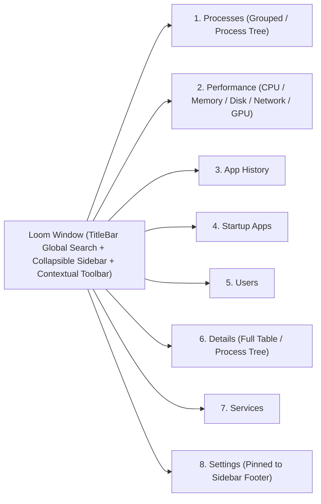

# Product design and feature audit

English | [中文](design.zh.md)

This specification serves two purposes:

1. **Feature audit** of the built-in Windows 11 Task Manager across all 8 views, multi-level context menus, hardware performance charts, and management dialogs, classifying each capability into **P0 core**, **P1 daily**, **P2 advanced diagnostics**, or **Drop (out of scope / legacy)**.
2. **Native desktop product and UI specification** for Loom built on GPUI Kit (`gpui-kit` / `gpui-component`), prioritizing standard component composition, anti-hang isolation, and fast startup (`< 50 ms` target), delivered by semantic version milestones in [Versioning and releases](release.md#versioned-roadmap).

## Part 1: Windows 11 Task Manager feature audit and triage

Priority tiers:

- **P0 (Core, targeted for `0.0.2` – `0.0.3`)**: Minimum daily task management loop—fast launch, process and process-tree inspection, Run new task, and process termination.
- **P1 (Daily, targeted for `0.0.4` – `0.0.5`)**: Real-time multi-device hardware performance charts plus Services, Startup Apps, Users, and App History views.
- **P2 (Advanced diagnostics, targeted for `0.0.6`)**: Deadlock inspection, crash dump capture, and power-user diagnostics.
- **Drop (Out of scope / legacy)**: OS telemetry hooks, legacy window modes, or startup-blocking patterns—explicitly excluded.

### 1. Global shell, OS integration & startup experience

| Audited Feature | Tier | Rationale & Handling |
| --- | :---: | --- |
| Window titlebar & centered global search (`Name`, `Publisher`, or `PID`) | **P0 (`0.0.2`)** | `TitleBar` + debounced `.cleanable(true)` `Input` filtering across table views. |
| Collapsible left navigation rail (expanded labels / icon rail + footer Settings) | **P0 (`0.0.2`)** | Built with `Sidebar` and `SidebarFooter`. |
| Standard-user `< 50 ms` launch target + on-demand UAC elevation | **P0 (`0.0.2`)** | No UAC prompt on launch; `ElevationRequired` triggers a non-blocking `Notification` with an elevated relaunch action. |
| Light / Dark / System theme switching | **P0 (`0.0.2`)** | Backed by the `gpui-kit` theme engine with live updates. |
| Bilingual UI (`zh-CN` / `en-US`) | **P0 (`0.0.2`)** | `rust-i18n` localization across views, context menus, and tray menus. |
| Resident system tray & `0% GPU` release on window close/minimize | **P0 (`0.0.2`)** | Closing the window destroys the GPUI surface to release VRAM; clicking the tray icon re-mounts the latest snapshot. |
| Top command bar `Run new task` button & dialog (Admin checkbox + Browse) | **P0 (`0.0.3`)** | `Dialog` + `Input` + `Checkbox`; invokes `ShellExecuteExW("runas")` when the elevated checkbox is checked. |
| Global wakeup hotkey | **P2 (`0.0.6`)** | Configurable single shortcut to summon and focus Loom. |
| Microsoft `Provide feedback` menu items & header button | **Drop** | OS-coupled Feedback Hub launcher; omitted from context menus and toolbars. |
| Legacy Win8/Win10 `Fewer details` chromeless mini-mode | **Drop** | Hides navigation and confuses users; replaced by a collapsible `Sidebar` and responsive columns. |
| Startup splash screen / XAML skeleton loading spinner | **Drop** | Loom targets rendering the first interactive process table in `< 50 ms` without a splash screen. |

### 2. Processes (`Processes`) & context menu

| Audited Feature | Tier | Rationale & Handling |
| --- | :---: | --- |
| Three-tier grouping (`Apps` / `Background processes` / `Windows processes`) + child expansion | **P0 (`0.0.3`)** | Classified via non-blocking `InternalGetWindowText` and DWM cloaked checks. |
| One-click toggle to parent-child `Process Tree` view | **P0 (`0.0.3`)** | Enforces `parent.create_time <= child.create_time` to avoid PID-reuse mismatches. |
| Process status indicators (`Efficiency mode` leaf, `Suspended`, `Not responding`) | **P0 (`0.0.3`)** | Derived from kernel thread states and non-blocking `IsHungAppWindow`. |
| Resource heatmap columns (`CPU`, `Memory`, `Disk`, `Network`, `GPU`) | **P0 (`0.0.3`)** | Quantized theme background opacity inside `TableDelegate::render_td`. |
| Context menu `Resource values >` (`Values` vs. `Percents` for Memory/Disk/Network) | **P0 (`0.0.3`)** | Nested `PopupMenu` persisted in `settings.toml`. |
| `End task` (toolbar button, `Delete` key, context menu) | **P0 (`0.0.3`)** | Selection anchored to `ProcessKey` so row resorts do not target the wrong process. |
| `Efficiency mode` (`EcoQoS`) toggle & checkmark state | **P0 (`0.0.3`)** | `SetProcessInformation(ProcessPowerThrottling)`; disabled on unsupported system processes. |
| `Go to details`, `Open file location`, `Search online`, `Properties` | **P0 (`0.0.3`)** | Standard workflow actions; `Go to details` switches views and scrolls to the target `ProcessKey`. |
| `Create memory dump file` & `Debug` | **P2 (`0.0.6`)** | Streamed off-thread `.DMP` creation with progress and cancel support. |

### 3. Performance (`Performance`) real-time telemetry center

| Audited Feature | Tier | Rationale & Handling |
| --- | :---: | --- |
| Left device rail with 60s thumbnail sparklines & summary text | **P1 (`0.0.4`)** | `v_virtual_list` + axis-free `AreaChart` (`point_count(60)`). |
| **CPU**: Switch between `Overall utilization` and `Logical processors` grid (e.g., 32-core `8×4`) | **P1 (`0.0.4`)** | Responsive grid of compact `AreaChart` cells without custom `Canvas`. |
| **CPU**: `Show kernel times` dual-layer shaded area overlay | **P1 (`0.0.4`)** | Multi-series `AreaChart` binding both total and kernel utilization series. |
| **CPU**: Live turbo speed, base speed, processes/threads/handles, uptime, sockets/cores, virtualization, L1/L2/L3 caches | **P1 (`0.0.4`)** | Static topology cached once at startup; dynamic counters updated in `< 0.2 ms` per tick. |
| **Memory**: 60s usage chart + 4-segment composition bar with hover tooltips | **P1 (`0.0.4`)** | `AreaChart` + proportional Flexbox segments + `Tooltip`. |
| **Memory**: In use, available, committed, cached, paged/non-paged pool + RAM speed, slots used, form factor | **P1 (`0.0.4`)** | Hardware specs parsed from raw `SMBIOS` firmware tables without WMI. |
| **Disk 0..N**: Volume letters (`C: D:`), model, NVMe/SATA/HDD type, Active time chart + Read/Write transfer chart + latency/capacity | **P1 (`0.0.4`)** | Static descriptors and `IOCTL_DISK_PERFORMANCE` counters isolated per device with `300 ms` circuit breakers. |
| **Ethernet / Wi-Fi**: Adapter model, auto-scaling Send/Receive chart, IPv4/IPv6/DNS/connection type | **P1 (`0.0.4`)** | Driven by `GetIfTable2` and `GetAdaptersAddresses`. |
| **GPU 0..N**: `2×2` multi-engine view (selectable `3D`/`Copy`/`Video Encode`/`Decode`) & single-engine view + Dedicated/Shared VRAM charts + temperature/driver/DX/PCI location | **P1 (`0.0.4`)** | Vendor-neutral `DXGI` + `gdi32!D3DKMTQueryStatistics` and `AdapterPerfData`. |

### 4. Details, Services, Startup Apps, Users & App History

| View | Audited Feature | Tier | Rationale & Handling |
| --- | --- | :---: | --- |
| **Details** | Full-column virtualized table + Process Tree toggle (`PID`, `Status`, `User`, `CPU`, `Working set`, `Platform` 32/64-bit, `UAC virtualization`, `Dedicated GPU memory`, `Command line`) | **P0 (`0.0.3`)** | Reuses shared `ProcessHotSample` and `ColdMeta` caches via on-demand slice projection. |
| **Details** | `End task`, bottom-up `End process tree`, `Set priority` (6 levels), `Set affinity` (CPU core checkbox dialog) | **P0 (`0.0.3`)** | Supports >64 logical processor group affinity masks. |
| **Details** | `Go to service(s)` (jumps to Services highlighting all services hosted in that `PID`) | **P1 (`0.0.5`)** | Bidirectional navigation with `Services`. |
| **Details** | `Analyze wait chain` (WCT dialog), `UAC virtualization` toggle, `Create dump`, `Debug` | **P2 (`0.0.6`)** | Renders cross-process thread wait graphs inside `gpui-kit` `Tree`. |
| **Services** | SCM table (`Name`, `PID`, `Description`, `Status`, `Group`), `Start` / `Stop` / `Restart`, `Open Services`, `Go to details` | **P1 (`0.0.5`)** | Gated by RAII `MonitorLease`; no SCM polling while inactive. |
| **Startup Apps** | Top-right `Last BIOS time`, `Name`/`Publisher`/`Status`/`Startup impact`, `Enable`/`Disable`, `Properties`, `Open file location` | **P1 (`0.0.5`)** | Aggregates Registry `Run`/`StartupApproved`, Startup folders, and UWP `StartupTask`. |
| **Users** | Per-session CPU/Memory/Disk/Network totals, expandable user process list, `Disconnect`, `Manage user accounts` | **P1 (`0.0.5`)** | WTS session enumeration joined in-memory by `SessionId`. |
| **App History** | Collection start date, `Name`/`CPU time`/`Network`/`Metered network` heatmap columns, `Delete usage history` | **P1 (`0.0.5`)** | Combines accessible OS usage counters with lightweight cumulative tracking. |

### 5. Settings (`Settings`)

| Audited Feature | Tier | Rationale & Handling |
| --- | :---: | --- |
| Default start page & real-time update speed (`High 0.5s` / `Normal 1s` / `Low 2s` / `Paused`) | **P0 (`0.0.2`)** | Inline selects with immediate apply; `Paused` suspends fast-sampler wakeups. |
| Window management: `Always on top`, `Hide when minimized`, `Close to system tray` | **P0 (`0.0.2`)** | Inline switches controlling window level and tray lifecycle. |
| Appearance & language: `Light` / `Dark` / `System`, `zh-CN` / `en-US` | **P0 (`0.0.2`)** | Live switching without restart. |
| Live kernel memory dump multi-option configuration | **Drop** | Niche multi-GB kernel debugging feature requiring elevated privileges; omitted to keep Settings focused. |

## Part 2: Native desktop product and UI design

### 1. Interaction principles

- **Component composition without custom drawing**: Tables, sparklines, multi-series charts, wait-chain trees, context menus, and dialogs compose standard `gpui-kit` (`gpui-component`) widgets.
- **Stable selection anchoring**: Under dynamic CPU/network sorting, row order changes every tick. Loom binds row selection, `Delete` shortcuts, and open context menus to **`ProcessKey (PID, CreateTime)`**, avoiding accidental actions against the wrong process when rows reorder.
- **Inline controls first, scoped modals when needed**: Preferences apply inline immediately; modal `Dialog`s are reserved for `Run new task`, `Set affinity`, `Analyze wait chain`, and destructive confirmations. Elevation prompts appear as non-blocking bottom-right `Notification`s.
- **Live data and lease-gated polling**: Views do not display static placeholder data; `Services`, `Startup Apps`, `Users`, and `App History` poll only while holding an active `MonitorLease`.

### 2. Information architecture (8-view layout)

### 3. Key view specifications

1. **Processes**:
   - Header bar includes a compact `Grouped` ↔ `Process Tree` view switcher on the left and `Run new task` and `End task` actions on the right (`Efficiency mode` is toggled via the row context menu).
   - Column 0 renders cached `20×20` icons, display names, and tree expanders; the status column renders compact icon-only badges with hover tooltips for `Efficiency mode`, `Suspended`, and `Not responding`; resource columns display subtle heatmap shading.
2. **Performance**:
   - Resizable split layout (`h_resizable`): left rail lists hardware devices with 60s sparklines; right pane displays device header and hardware model string, interactive `AreaChart`/`LineChart` plots (supporting overall/logical-core and kernel-time toggles on CPU, plus `2×2` multi-engine / single-engine views on GPU), and a two-column metric grid below.
3. **Cross-view navigation**:
   - `Go to details` from `Processes` or `Services` activates `Details` and scrolls the target `ProcessKey` into view; `Go to service(s)` from `Details` activates `Services` filtered/highlighted to all services sharing that host `PID`.
4. **Run new task & diagnostic dialogs**:
   - `Run new task` supports Enter-to-run, recent command history, native `Browse...` file picker, and administrative elevation checkbox;
   - `Analyze wait chain` renders thread/process blocking chains inside a `Tree` with direct termination support for blocking targets.

## Part 3: Versioned delivery plan

Delivery follows semantic version milestones rather than abstract phases: core engine and shell infrastructure in `0.0.1`–`0.0.2`, daily-usable `P0` Windows process management in **`0.0.3`**, `P1` hardware performance and management views in `0.0.4`–`0.0.5`, `P2` diagnostics and benchmarking in `0.0.6`, stable Windows release at **`0.1.0`**, and Linux (`0.2.0`) / macOS (`0.3.0`) backends afterward. See the milestone table and exit criteria in [Versioning and releases](release.md#versioned-roadmap).
