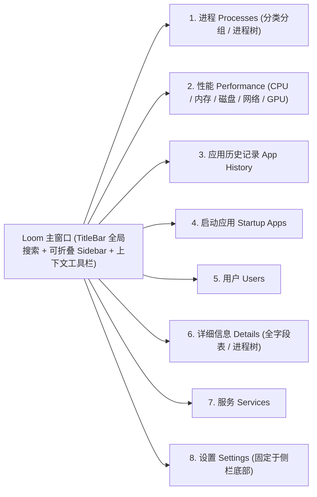

# 产品设计与功能盘点

[English](design.md) | 中文

本文档包含两部分内容：
1. **功能盘点**：梳理 Windows 11 自带任务管理器的 8 个页面、多级右键菜单、硬件性能图表与管理对话框中的各项功能，划分为 **P0 核心 / P1 日常 / P2 进阶诊断 / Drop 剔除项**；
2. **界面规格**：定义 Loom 基于 GPUI Kit（`gpui-kit` / `gpui-component`）的组件组合、防阻塞与快速启动（`< 50 ms` 目标）桌面产品规范，并按[版本与发布](release.zh.md#versioned-roadmap)中的语义化版本号推进交付。

## 第一部分：对标 Windows 11 任务管理器功能盘点与分级

分级说明：
- **P0（核心功能，对应 `0.0.2` – `0.0.3`）**：覆盖日常进程查看、进程树识别、运行新任务与终止进程的最小闭环。
- **P1（日常功能，对应 `0.0.4` – `0.0.5`）**：覆盖多设备硬件实时图表，以及服务、启动应用、用户会话与应用历史管理视图。
- **P2（进阶诊断，对应 `0.0.6`）**：覆盖等待链死锁排查、内存转储与高级调优能力。
- **Drop（超出范围 / 历史遗留）**：绑定系统遥测、易致启动阻塞或偏离核心职责的功能，明确排除。

### 1. 全局壳层、系统集成与启动体验

| 对标功能 | 决策 | 说明与处理方式 |
| :--- | :---: | :--- |
| 窗口标题栏与顶部全局搜索框（名称 / 发布者 / PID） | **P0 (`0.0.2`)** | 基于 `TitleBar` + 防抖 `Input`，在进程/详细信息/服务/启动项/用户/历史页实时过滤 |
| 左侧可折叠导航栏（展开文字 / 收起仅图标 + 底部设置） | **P0 (`0.0.2`)** | 基于 `Sidebar` + `SidebarFooter` 实现 |
| 普通用户权限启动（`< 50 ms` 目标）+ 按需 UAC 提权 | **P0 (`0.0.2`)** | 启动阶段不触发 UAC 弹窗；操作受保护对象被拒绝时通过 `Notification` 提供以管理员重启入口 |
| 浅色 / 深色 / 跟随系统主题切换 | **P0 (`0.0.2`)** | 对接 `gpui-kit` 主题系统，即时生效 |
| 中英双语切换（`zh-CN` / `en-US`） | **P0 (`0.0.2`)** | 基于 `rust-i18n` 覆盖桌面界面、右键菜单与托盘菜单 |
| 最小化/关窗常驻系统托盘并释放 GPU 显存 | **P0 (`0.0.2`)** | 关闭窗口时销毁 GPUI 窗口以释放显存（`0% GPU`）；点击托盘图标时重新挂载最新快照 |
| 页面顶栏「运行新任务」按钮与弹窗（含管理员勾选 + 浏览） | **P0 (`0.0.3`)** | 基于 `Dialog` + `Input` + `Checkbox`，勾选管理员时调用 `ShellExecuteExW("runas")` |
| 全局唤醒快捷键 | **P2 (`0.0.6`)** | 支持配置单组快捷呼出热键 |
| 微软「提供反馈(B)」右键菜单项与顶栏入口 | **Drop** | 绑定 Windows Feedback Hub 的系统入口，在菜单与工具栏中移除 |
| Win8/Win10 遗留「简略信息」无导航小窗模式 | **Drop** | 隐藏导航栏易导致误操作，由可折叠 `Sidebar` 与响应式列宽替代 |
| 启动欢迎屏 / XAML 异步骨架加载动画 | **Drop** | 首帧目标在 `< 50 ms` 内直接渲染进程表，不设启动过渡屏 |

### 2. 进程（`Processes`）与右键菜单

| 对标功能 | 决策 | 说明与处理方式 |
| :--- | :---: | :--- |
| 三段式分类分组（应用 / 后台进程 / Windows 进程）与子进程展开 | **P0 (`0.0.3`)** | 通过非阻塞 `InternalGetWindowText` 与 DWM Cloaked 状态分类，首列提供折叠箭头；Windows 分组视图按应用身份（MSIX/UWP 包家族名或可执行文件身份）将同应用多进程聚合至顶层应用行并展示组内总进程数，不同映像的后台子进程留在后台进程，且 `explorer.exe` 不吞并独立应用或后台进程 |
| 父子进程树视图一键切换（`Process Tree`） | **P0 (`0.0.3`)** | 校验 `parent.create_time <= child.create_time` 防止 PID 复用造成误挂载 |
| 进程状态列（效能模式绿叶标识、已挂起、未响应） | **P0 (`0.0.3`)** | 基于内核线程挂起态与非阻塞 `IsHungAppWindow` 判定 |
| 资源占用热力图列（CPU、内存、磁盘、网络、GPU） | **P0 (`0.0.3`)** | 在 `TableDelegate::render_td` 中按占用分档映射单元格背景透明度 |
| 右键「资源值(V) >」切换内存/磁盘/网络显示「数值」或「百分比」 | **P0 (`0.0.3`)** | 二级 `PopupMenu` 切换显示格式并持久化至 `settings.toml` |
| 结束任务（工具栏按钮、`Delete` 键、右键菜单） | **P0 (`0.0.3`)** | 选中态锚定 `ProcessKey`，避免行重排时误操作其他进程 |
| 效能模式（`EcoQoS`）状态展示与右键开关 | **P0 (`0.0.3`)** | 调用 `SetProcessInformation(ProcessPowerThrottling)`，不支持的系统进程置灰 |
| 转到详细信息 / 打开文件所在的位置 / 在线搜索 / 属性 | **P0 (`0.0.3`)** | 保留常用联动操作，`转到详细信息` 切换页面并滚动高亮对应 `ProcessKey` |
| 创建内存转储文件 / 附加调试器 | **P2 (`0.0.6`)** | 后台线程流式写出 `.DMP` 文件，提供进度提示与取消按钮 |

### 3. 性能（`Performance`）实时监控中心

| 对标功能 | 决策 | 说明与处理方式 |
| :--- | :---: | :--- |
| 左栏硬件列表（60s 微缩波形图 + 摘要文字） | **P1 (`0.0.4`)** | `v_virtual_list` + 隐藏坐标轴的紧凑 `AreaChart` |
| **CPU**：总体利用率与多逻辑核心网格（如 32 核 `8×4`）切换 | **P1 (`0.0.4`)** | 响应式网格复用 `AreaChart`，不手写自定义 `Canvas` |
| **CPU**：「显示内核时间」双层面积图叠加 | **P1 (`0.0.4`)** | 多序列 `AreaChart` 同时绑定总利用率与内核利用率序列 |
| **CPU**：动态主频、基准频率、进程/线程/句柄数、运行时间、插槽/核数、虚拟化、L1/L2/L3 缓存 | **P1 (`0.0.4`)** | 静态拓扑启动时缓存一次，动态计数每周期 `< 0.2 ms` 更新 |
| **内存**：60s 使用率曲线 + 四段内存组成条（悬停提示详情） | **P1 (`0.0.4`)** | `AreaChart` + Flexbox 比例宽度色块 + `Tooltip` |
| **内存**：使用中/可用/已提交/已缓存/分页与非分页池 + 频率/插槽/外形规格 | **P1 (`0.0.4`)** | 硬件规格直接解析 `SMBIOS` 原始固件表，不依赖 WMI |
| **磁盘 0..N**：盘符映射（如 `C: D:`）、型号、NVMe/SATA/HDD 类型、活动时间图 + 读写速率图 + 响应时间/容量 | **P1 (`0.0.4`)** | 物理盘静态属性与 `IOCTL_DISK_PERFORMANCE` 采样均按设备隔离并受 `300 ms` 熔断器保护 |
| **以太网 / Wi-Fi**：网卡型号、自适应量纲收发吞吐双曲线、IPv4/IPv6/DNS/连接类型 | **P1 (`0.0.4`)** | 基于 `GetIfTable2` 与 `GetAdaptersAddresses` |
| **GPU 0..N**：`2×2` 多引擎视图（下拉切换 3D/Copy/Video Encode/Decode）与单引擎视图 + 专享/共享显存图 + 温度/驱动/DX版本/PCI位置 | **P1 (`0.0.4`)** | 基于厂商中立的 `DXGI` + `gdi32!D3DKMTQueryStatistics` 与 `AdapterPerfData` |

### 4. 应用历史记录、启动应用、用户、详细信息与服务

| 页面 | 对标功能 | 决策 | 说明与处理方式 |
| :--- | :--- | :---: | :--- |
| **详细信息 (`Details`)** | 全字段虚拟化表格 + 进程树模式切换（PID、状态、用户名、CPU、专用工作集、32/64位平台、UAC虚拟化、专用GPU内存、命令行等） | **P0 (`0.0.3`)** | 复用共享的 `ProcessHotSample` 与 `ColdMeta` 缓存，按需投影 |
| **详细信息 (`Details`)** | 结束任务、自底向上**结束进程树**、设置优先级（6 档）、设置 CPU 相关性（核心勾选弹窗） | **P0 (`0.0.3`)** | 支持超过 64 逻辑核的处理器组掩码 |
| **详细信息 (`Details`)** | 转到服务（切换至服务页并高亮同一 `PID` 宿主下的所有服务） | **P1 (`0.0.5`)** | 与服务页双向联动 |
| **详细信息 (`Details`)** | 分析等待链（WCT 阻塞树弹窗）、UAC 虚拟化切换、创建转储、调试 | **P2 (`0.0.6`)** | 使用 `gpui-kit` `Tree` 展示跨进程线程等待链 |
| **服务 (`Services`)** | 服务列表（名称、PID、描述、状态、服务组 `LoadOrderGroup`）、启动/停止/重启、打开 `services.msc`、转到详细信息 | **P1 (`0.0.5`)** | 绑定 `MonitorLease`，未查看页面时不轮询 SCM |
| **启动应用 (`Startup`)** | 右上角「上次 BIOS 所用时间」、名称/发布者/状态/启动影响、启用/禁用、属性、打开文件位置 | **P1 (`0.0.5`)** | 聚合注册表 `Run`/`StartupApproved`、启动目录与 UWP `StartupTask` |
| **用户 (`Users`)** | 会话级 CPU/内存/磁盘/网络汇总、展开查看会话进程及状态、断开连接、管理用户账户 | **P1 (`0.0.5`)** | 基于 WTS 会话 API 与进程 `SessionId` 在内存中聚合 |
| **应用历史 (`App History`)** | 统计起始日期、名称/CPU时间/网络/计费网络热力图列、「删除使用情况历史记录」 | **P1 (`0.0.5`)** | 结合系统可用历史接口与轻量级累计统计 |

### 5. 设置（`Settings`）

| 对标功能 | 决策 | 说明与处理方式 |
| :--- | :---: | :--- |
| 默认启动页、实时更新速度（高 `0.5s` / 正常 `1s` / 低 `2s` / 已暂停） | **P0 (`0.0.2`)** | 内联下拉即时生效，暂停态挂起快采定时器 |
| 窗口管理：始终置顶（Always on top）、最小化时隐藏到托盘、关窗最小化到托盘 | **P0 (`0.0.2`)** | 内联开关控制原生窗口属性与托盘生命周期 |
| 外观与语言：浅色 / 深色 / 跟随系统、中文 / English | **P0 (`0.0.2`)** | 无重启即时切换 |
| 实时内核内存转储（Live Kernel Memory Dump 多项配置） | **Drop** | 涉及多 GB 全系统内核转储与特殊权限，使用频次低，不纳入设置页 |

## 第二部分：Loom 原生桌面产品与交互设计

### 1. 交互准则

- **组件组合、避免自绘**：表格、微缩波形图、多序列面积图、等待链树、右键菜单与对话框均直接组合 `gpui-kit`（`gpui-component`）标准控件，保证跨 DPI 清晰度、主题一致性与可维护性。
- **防跳行误操作**：动态排序下，表格行序每秒可能变化。行选中态、快捷键（`Delete` 结束任务）与打开中的右键菜单均绑定 **`ProcessKey (PID, CreateTime)`**，避免行重排导致操作落到错误进程上。
- **内联优先、按需模态**：设置项采用单页内联控件即时生效；仅「运行新任务」、「设置相关性」、「分析等待链」与高危确认（如结束系统关键进程、断开其他用户会话）使用轻量 `Dialog`；权限受阻采用右下角非阻塞 `Notification` 并提供提权入口。
- **真实数据与按需租约**：界面不保留静态占位假数据；`服务`、`启动应用`、`用户`、`应用历史记录` 仅在挂载期间持有 `MonitorLease`，离开页面即停止轮询。

### 2. 信息架构（8 视图布局）

### 3. 视图交互规格

1. **进程（Processes）**：
   - 顶栏左侧提供纯图标视图切换控件（`分组视图` ↔ `进程树`，悬停展示提示文案），右侧放置「运行新任务」与「结束任务」按钮（效能模式通过右键菜单切换）。
   - 表头支持拖拽列边框调整列宽、左右拖拽列标题重排列序（会话内跨页切换保持布局）；首列展示应用图标、友好名称与折叠箭头；状态列以纯图标徽章展示效能模式、挂起与未响应状态（悬停显示提示文案）；CPU/内存/磁盘/网络/GPU 列附带柔和热力图底色。
2. **性能（Performance）**：
   - 采用可拖拽宽度的左右双栏布局（`h_resizable`）：左栏为带 60s 微缩图的设备列表；右栏顶部显示设备标题与硬件型号，中部为主图表区（右键切换 CPU 总体/逻辑处理器、显示内核时间，GPU 支持 `2×2` 多引擎与单引擎视图），底部为双列指标面板。
3. **跨页导航联动**：
   - 在「进程」或「服务」中点击「转到详细信息」切换至 `Details` 并滚动选中对应 `ProcessKey`；在 `Details` 中点击宿主进程的「转到服务」切换至 `Services` 并高亮过滤该 `PID` 承载的服务项。
4. **运行新任务与诊断对话框**：
   - 「运行新任务」支持回车执行、历史命令记忆、`浏览...` 原生文件选择器及管理员权限复选框；
   - 「分析等待链」以树形结构列出阻塞线程、等待对象类型（Mutex / ALPC / File / Process）及持有者进程，支持在弹窗内直接结束阻塞目标进程。

## 第三部分：按版本号驱动的交付计划

交付顺序按语义化版本号推进：`0.0.1`–`0.0.2` 完成无头引擎、PAL 与桌面壳层，`0.0.3` 达成日常可用的 `P0` Windows 进程管理核心，`0.0.4`–`0.0.5` 交付 `P1` 性能监控与系统管理视图，`0.0.6` 完成 `P2` 诊断能力与压测调优，`0.1.0` 发布首个 Windows 稳定版，随后于 `0.2.0` / `0.3.0` 扩展 Linux 与 macOS 后端。各里程碑范围与验收标准见[版本与发布](release.zh.md#versioned-roadmap)。
